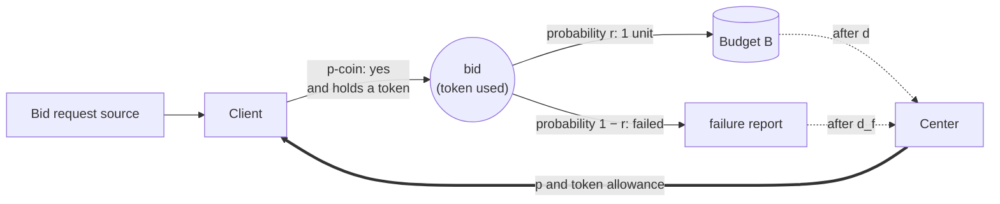
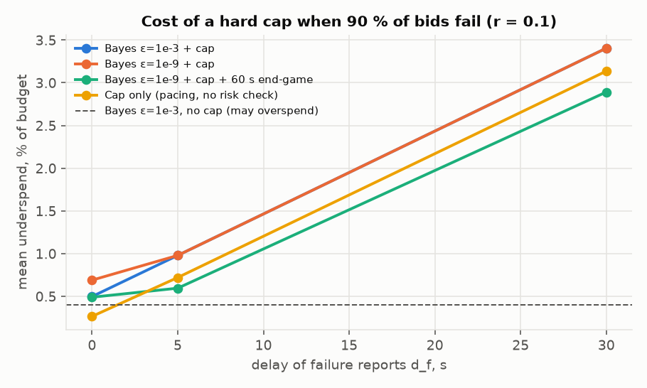

# Token-cap backstop: making overspend impossible

Companion to [MODEL.md](MODEL.md). The probabilistic controller there keeps the
chance of overspend at or below ε, but it cannot reach zero. Spend becomes
visible only after the delay d, and a Poisson burst has no upper limit. This file
describes a **hard cap** that makes overspend impossible, why it works, what it
costs, and how to combine it with the controller.

Code: `src/pacing/backstop.py` · tests: `tests/test_backstop.py` ·
results: `results/backstop.md`, `results/backstop.png`
(run `uv run python -m pacing.backstop`).

## 1. Idea

The controller has to *guess* how much spend is in flight, because the budget
shows spend only d seconds after it happens. The cap removes the guess. Every
bid needs a **token**, and the center counts tokens **when it grants them**. The
center then always knows an upper bound on everything that can still be
charged: each granted token costs at most 1 unit. If granted tokens never exceed
what the budget can pay for, overspend cannot happen, whatever the traffic, the
delay, the controller or a lost message does.

The price: a token whose bid will fail still holds budget until the center knows
it failed. When many bids fail and that takes long, the held budget cannot be
spent at the end of the campaign.

There are two versions. They differ in how the center learns that a granted
token can no longer cost anything:

| | **(a) Failure reports** (§2–6) | **(b) No reports from clients** (§7) |
|---|---|---|
| Center counts | tokens used, failures reported | only tokens it granted; they expire after one control step |
| Allowance | A = B + F_obs − U | A = B − S_obs − (tokens granted in the last d seconds) |
| Clients report | failures (after d_f), tokens used, blocked bids | nothing |
| Guarantee holds if | failure reports are truthful; late reports are safe | the spend delay d is never exceeded |
| Cost driven by | failure-report delay d_f | spend delay d, and how many tokens are granted |

## 2. Configuration (version a)

Compared with MODEL.md §1, the actors are the same. Only the client's rule and
the messages change.

| | Without the cap (MODEL.md) | With the cap |
|---|---|---|
| Client bids when | the p-coin says yes | the p-coin says yes **and** it holds a token. The token is used up. |
| Center → clients | p, broadcast | p, broadcast, plus a **token allowance** |
| Clients → center | nothing | **failure reports** (a used token was not charged), after delay d_f, and the number of **blocked bids** |
| Budget → center | spend, after delay d | spend, after delay d (no longer needed for safety) |

Life of a bid with the cap:

1. A request reaches a client, chosen at random.
2. The client flips its p-coin. On "no" the request is dropped, as before.
3. On "yes" the client needs a token. If none is left, the bid is **blocked**,
   and the client counts it.
4. With a token, the client bids and the token is used up.
5. With probability r the bid is charged 1 unit, which appears in the budget
   after d. Otherwise it fails, and the client reports the failure to the center
   after d_f.

## 3. The center's rule and why it guarantees B (version a)

The center keeps two counters:

- **U**: tokens used so far. The center knows U exactly, because it granted
  them and clients report blocked bids.
- **F_obs**: failures reported so far.

At the start of every control step it sets the allowance for that step:

    A = B + F_obs − U

Clients together may use at most A tokens during the step. In the simulation the
allowance is one shared pool; §6 covers real wallets.

**Proof.** Every unit of spend comes from a used token that did not fail. Let
F_total be all failures, reported or not. Then

    spend = U − F_total ≤ U − F_obs ≤ B,

because F_obs ≤ F_total, and the allowance rule keeps U ≤ B + F_obs at all
times. ∎

The proof uses no probability, no Poisson assumption and no delay d. It holds
when traffic is bursty, when the delay runs long, when a stop message is lost,
and when the controller misbehaves. The tests check it with a controller that
always bids at p = 1 (`test_cap_makes_overspend_impossible_even_at_full_throttle`).

What it does need:
- clients cannot bid without a token, which is an enforcement point on the client;
- a token's bid costs at most 1 unit;
- failure reports are never false. A late report is safe: it only holds budget
  longer.

## 4. Where the cost comes from (version a)

At any moment the allowance equals

    A = (B − true spend) − (failures not yet reported)

so the budget the cap holds back is exactly the **unreported failures**. If
tokens are used at rate u, about (1 − r)·u·d_f′ failures are unreported at any
time. Here d_f′ is the failure-report delay plus half a control step, because
reports arrive at step boundaries.

**End of the campaign.** With even pacing, spend runs at ρ = B/T, so tokens are
used at u = ρ/r. The cap starts to bind once the remaining budget falls to the
unreported failures,

    x₀ = (1 − r)·ρ·d_f′ / r.

After that, the remaining budget can shrink only as fast as failures are
reported, so it decays exponentially with time constant

    τ = (1 − r)·d_f′ / r.

At pace ρ the cap starts to bind x₀/ρ = τ before T, so at T the unspent budget
is about x₀·e⁻¹. As a share of the budget:

    underspend ≈ (1 − r) · d_f′ / (e · r · T)

| r | d_f | rule of thumb | simulated (cap + plain pacing) |
|---|---|---|---|
| 1.0 | any | 0 % | 0.00 % |
| 0.5 | 0 s | 0.03 % | 0.00 % |
| 0.5 | 5 s | 0.08 % | 0.02 % |
| 0.5 | 30 s | 0.33 % | 0.29 % |
| 0.1 | 0 s | 0.23 % | 0.26 % |
| 0.1 | 5 s | 0.69 % | 0.72 % |
| 0.1 | 30 s | 2.99 % | 3.14 % |

(Control step Δ = 5 s, so d_f′ = d_f rounded up to whole steps, plus 2.5 s.)

What the formula shows:
- **The share of failing bids matters most**, through (1 − r)/r. At r = 1 the
  cost is zero: a token is the spend.
- **Failure reports should be fast.** The cost is proportional to d_f′. The
  spend delay d does not appear at all.
- **Budget size and traffic do not matter.** The cost as a share of the budget
  does not depend on B or λ. The probabilistic controller's cost, by contrast,
  falls like 1/√B (MODEL.md §4, item 2). So for large budgets with slow
  failure reports, the probabilistic controller can be the cheaper of the two.
- **Longer campaigns help.** The cost falls like 1/T.
- **Slowing down at the end helps.** A lower pace just before T means fewer
  unreported failures when the budget runs out. That is why the 60 s end-game
  improves the cap's cost (§5).

## 5. Simulation results (version a)

Default scenario: B = 5000, T = 3600 s, d = 30 s, Δ = 5 s. k = λ·r = 100 is held
fixed while r varies, so the spend process is the same in every row. 20,000 runs
per row, mean budget left unspent; full table in `results/backstop.md`.

| r | d_f | Bayes ε = 10⁻³, no cap | Bayes ε = 10⁻³ + cap | Cap only | Bayes ε = 10⁻⁹ + cap + 60 s end-game |
|---|---|---|---|---|---|
| 1.0 | 30 s | 0.40 % (19 overspends) | 0.40 % | **0.00 %** | 0.49 % |
| 0.5 | 5 s | 0.40 % (18 overspends) | 0.40 % | **0.02 %** | 0.49 % |
| 0.5 | 30 s | same | 0.52 % | **0.29 %** | 0.49 % |
| 0.1 | 0 s | 0.40 % (16 overspends) | 0.50 % | **0.26 %** | 0.49 % |
| 0.1 | 5 s | same | 0.98 % | 0.72 % | **0.60 %** |
| 0.1 | 30 s | same | 3.40 % | 3.14 % | **2.89 %** |

"Cap only" means plain pacing (`NaiveController`) with the cap and no risk
check. **Every row with the cap had zero overspends.**

Observations:

1. **With a cap, the risk check is not needed for safety, and stacking it costs
   extra.** Each mechanism stops spending on its own terms, so "Bayes + cap" is
   never better than "cap only" with the same pacing.
2. **Cap only is the best design when the cap is cheap:** r ≥ 0.5, or failures
   reported within a few seconds. It also beats the probabilistic controller
   (0.40 %), which on top of that still allows overspend.
3. **When the cap is expensive (r = 0.1, d_f = 30 s), slowing down at the end is
   what helps**, not the risk check: the end-game brings 3.14 % down to 2.89 %.
   A longer end-game, or tapering the pace into the end, would help more.
4. **Evenness.** The cap blocks bids only near the end, so spending stays even:
   1.2–1.5 % maximum deviation, or 2.1 % with the deliberate 60 s end-game. The
   exception is r = 0.1 with d_f = 30 s (3.1–3.4 %), where blocking starts about
   τ ≈ 5 minutes before T.

## 6. Simulation details and simplifications (version a; version b in §7)

Each control step:

1. The controller picks p from what it sees (visible spend, its exposure, the
   in-flight window), exactly as in MODEL.md.
2. Clients want to make `wanted ~ Poisson(λ·p·Δ)` bids.
3. The cap allows `tokens = min(wanted, A)`. The rest are blocked.
4. Charged bids: `x ~ Binomial(tokens, r)`. They appear in the budget after d.
   Failures (`tokens − x`) are reported after d_f.
5. **Exposure correction.** Clients report blocked bids, so the center records
   the exposure that actually happened, p·Δ·tokens/wanted, not p·Δ. Without
   this, blocked bids would look like a low spend rate and drag k̂ down.

Simplifications:

- **One shared token pool.** In reality tokens sit in each client's wallet. A
  client may hold tokens it doesn't use while another is blocked. With leases of
  L tokens to N clients, up to about N·L tokens can be held when the budget runs
  out, and that budget is lost. Keep leases small near the end: shrink L as the
  allowance falls, and let unused tokens expire after a short lease time.
- **Allowance per control step.** A real implementation can refill continuously.
  Δ enters only through d_f′.
- **Failure reports are exact**, with a fixed delay. A random delay makes the cap
  hold budget longer but keeps it safe.
- **Steady traffic, as in MODEL.md.** Unlike the probabilistic guarantee, the
  cap's guarantee does not depend on this. Only its cost does.

## 7. Version (b): a cap without reports from clients

Version (a) needs clients to report failures, tokens used and blocked bids.
Version (b) needs **nothing from clients**. It uses only what the center already
has: the tokens it granted, and the budget.

### Rule

At the start of each control step i the center grants G_i tokens, **valid only
during that step**. Unused tokens expire. It never grants more than

    A_i = B − S_obs − (tokens granted in the last d seconds)

where S_obs is the spend visible in the budget, as in MODEL.md.

**Proof.** The spend delay d is fixed (MODEL.md, answer A). So the spend from
every step older than d is already in S_obs, and the only spend not yet visible
comes from the steps of the last d seconds. Each of those steps spent at most
the tokens it was granted. Hence

    total spend ≤ S_obs + (tokens granted in the last d seconds) + G_i ≤ B. ∎

Tokens that expired unused or whose bids failed need no report. Once their step
is older than d, the budget shows what they actually cost, and the center stops
counting them.

### What (b) gives up

- **Its guarantee depends on the delay.** If a charge ever reaches the budget
  later than d, the proof breaks. Version (a) has no such assumption: a late
  failure report only holds budget longer. So use (b) only if d is a hard
  maximum, such as a guaranteed settlement time, not a typical delay.
- **The center must choose how many tokens to grant.** It does not see demand
  (bids per step), and it cannot compute it from k̂, because it knows only
  k = λ·r, not λ.
  - Grant too few, and bids are blocked while budget is still free.
  - Grant too many, and unused grants hold budget for d seconds.
- **Blocked bids are invisible.** Without blocked-bid counts the center cannot
  correct its exposure, so blocking looks like a lower k. This affects only the
  end of the campaign, when the cap binds.

### Grant rules simulated

- **Share s** (needs no information): G_i = ⌈s·A_i⌉. Early on A_i is large, so the
  grants are far above demand and cost nothing. Near the end they shrink with
  the free budget.
- **Headroom h** (needs demand, for example from usage counts):
  G_i = min(A_i, ⌈h·λ·p·Δ⌉).

Grant share s, plain pacing with the cap, mean underspend (maximum pacing deviation):

| r | s = 0.14 | 0.29 | 0.43 | **0.57** | 0.71 | 0.86 |
|---|---|---|---|---|---|---|
| 0.1 | 6.2 % (6.2) | 4.4 % (4.4) | 3.8 % (3.8) | 3.5 % (3.5) | 3.2 % (3.3) | 2.5 % (**6.7**) |
| 0.5 | 0.80 % (1.4) | 0.49 % (1.4) | 0.40 % (1.4) | 0.36 % (1.4) | 0.33 % (1.7) | 0.29 % (**4.5**) |
| 1.0 | 0.13 % (1.4) | 0.03 % (1.4) | 0.01 % (1.4) | 0.01 % (1.4) | 0.02 % (1.6) | 0.06 % (**3.9**) |

A larger share leaves less unspent, up to about s ≈ 0.6–0.7. Beyond that,
spending becomes bursty: one step takes almost all of the allowance, and the
next d seconds get almost nothing. **s = 0.5, "grant half of what is free", is a
good default.**

### Results

Default scenario, 20,000 runs per row, plain pacing with the cap. Full table in
`results/backstop.md`.

| r | (b) share 0.5 | (b) share 0.5 + 60 s end-game | (b) headroom 1.5 | (a) failure reports, d_f = 30 s |
|---|---|---|---|---|
| 1.0 | 0.01 % | **0.00 %** | 0.03 % | **0.00 %** |
| 0.5 | 0.38 % | **0.13 %** | 0.32 % | 0.29 % |
| 0.1 | 3.63 % | 3.16 % | 3.17 % | 3.14 % |

**Zero overspends in every row.** The tests confirm this also for a controller
that always bids at p = 1, and for every grant rule.

What this shows:

1. **(b) costs about the same as (a) with failure reports delayed by d.** In (b)
   a token stays unresolved until its step is older than d, so the cost formula
   of §4 applies with d_f′ = d + Δ/2: 2.99 % predicted vs 3.17 % simulated at
   r = 0.1. If clients could report failures faster than d, version (a) would be
   cheaper.
2. **Knowing demand helps little.** Share 0.5 needs no information and is within
   about 0.5 percentage points of headroom 1.5. That is the largest gap, at
   r = 0.1; at r ≥ 0.5 it is 0.06 points or less.
3. **When every bid is charged (r = 1), (b) is almost free** (0.01 %), and free
   with an end-game. With r = 1 a token *is* the spend, so (b) only has to wait
   d to see the spend of tokens granted.
4. **The end-game helps (b) the most at r = 0.5**: 0.38 % → 0.13 %.

## 8. Recommendations

1. **If clients can be required to hold tokens, use the cap.** It is the only
   way to make overspend impossible rather than unlikely. It also protects
   against failures the statistics cannot: lost stop messages, misbehaving
   clients, delays longer than expected (version a).
2. **Choose the version by what you can trust:**
   - **(b), no client reports, grant share 0.5:** the simplest. Use it if the
     spend delay d is a hard maximum.
   - **(a), failure reports:** use it if delays can vary, or if failures can be
     reported much faster than d. Report a failure as soon as the bid's outcome
     is known, not when billing settles.
3. **Choose the pacing by the cap's expected cost, (1 − r)·d_f′ / (e·r·T)**, with
   d_f′ = d + Δ/2 for version (b):
   - small (under ~0.3 %): plain pacing plus the cap, with no risk check;
   - large: add an end-game or a taper, so less is unresolved at the end;
   - very large, for example a large budget with slow reports: the token-aware
     risk check below.
4. **Possible improvement: a token-aware risk check.** The cap holds back all
   unreported failures, but only a share 1 − r of unresolved tokens will fail,
   so the center can predict how many will. It could let the allowance exceed
   B + F_obs − U by an amount whose overspend risk is ε, using the
   Binomial(unresolved, r) distribution. This is much tighter than the Poisson
   in-flight estimate, because the token count is known. It gives up certainty
   again for ε, so it suits campaigns where ε is acceptable and the cap's cost
   is not.
