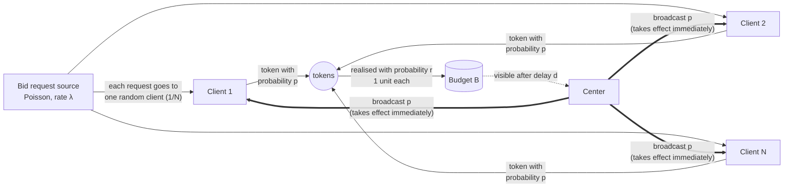

# Budget pacing with delayed feedback: model and strategy

Initial problem statement and clarifications: `INITIALMODEL.MD`.
Code: `src/pacing/` · tests: `tests/` · numbers and charts: `results/`.
How k and the pace are computed, and the Elixir implementation: [IMPLEMENTATION.md](IMPLEMENTATION.md).
Hard cap that makes overspend impossible: [BACKSTOP.md](BACKSTOP.md).

## 1. System configuration

### Actors

The system has three kinds of participants.

1. **Bid request source.** One common stream of bid requests (auction
   opportunities). Requests come one at a time at random moments, about λ per
   second on average. In this version the rate is steady: a Poisson process with
   constant λ. Nobody controls the source, and the center does not know λ.

2. **Clients** (bidders). There are N of them. The center does not know N, and it
   does not need to. Every client listens to the same source, and each request is
   delivered to **exactly one** client, chosen at random with equal probability
   1/N. A client that receives a request responds with a **token** with
   probability p, or ignores the request with probability 1 − p. A token is the
   client's decision to bid. It is not yet money: bidding and actually being
   charged are separate events. Clients have no token limit. Every client uses
   the same p, which it gets from the center and uses until the center sends a
   new one.

3. **Center.** The center owns the **budget B** and has to spend it within the
   **horizon T** (for example, one campaign hour). It never sees bid requests or
   tokens directly. Its only view is the budget, which shows the spend with a
   delay d. Its only control is p, which it broadcasts to all clients at once.
   Clients apply a new p immediately, so the center can stop all spending at once
   by sending p = 0.

### What happens to a single bid request

1. The source emits a request at time s.
2. The request reaches one client, chosen at random.
3. The client creates a token with probability p (it bids), or drops the request.
4. The token turns into real spend with probability r. Otherwise it costs
   nothing, for example because the bid lost or was never charged. Realised spend
   is always exactly **1 budget unit**. The center does not know r, but r is stable.
5. The 1 unit is taken from the budget at time s, but the center sees it only at
   time s + d. The delay d is fixed and known.



### The control loop

The center acts every Δ seconds. This is the **control period**, the `step`
parameter, 5 s by default:

1. Read the visible budget. It shows all spend up to time t − d.
2. Update the estimate of how much one unit of p spends per second (k = λ·r, §2).
3. Choose a new p. Pacing says how fast to spend. The risk check says how much
   spend can be in flight without risking overspend (§3).
4. Broadcast p to all clients. By default the center sends p every period. With
   a **broadcast threshold** it sends p only when p changes by more than that
   fraction, and clients keep the last p they received. A stop (p = 0) is always
   sent.

Between updates p is constant. The budget is read only at the start of each
period, so the delay d is effectively rounded up to a whole number of periods.

The center therefore steers using a view of the budget that is d seconds old.
Spend that happened during the last d seconds is **in flight**: it has already
been charged but the center cannot see it yet. That is the whole difficulty. If
d = 0, the center could spend until exactly B and stop. With d > 0, it must stop
early enough that the in-flight spend still fits in the budget.

### Goals and constraints

- **Overspend is critical.** The probability that total spend exceeds B must stay
  at or below a small, chosen ε.
- **Underspend should be avoided, but it is not critical.** Spend as close to B as
  ε allows.
- **Do not spend too fast.** Spend should be spread over the whole horizon,
  ideally at a steady rate of about B/T. It should not all go at the start.

### Example with the default numbers

λ = 1000 requests/s and r = 0.1, so k = λ·r = 100 units/s at p = 1. To spend
B = 5000 units in T = 1 h, the target rate is about 1.39 units/s, which needs
p ≈ 0.014. At that rate about 14 of the 1000 requests per second become tokens,
and about 1.4 of those become spend. With d = 30 s, about 42 units are in flight
at any moment. Near the end of the hour, those 42 units are what can push the
total over B.

## 2. Formal model

| Symbol | Meaning | Known to center? |
|---|---|---|
| B | budget, in units (one realised token costs exactly 1 unit) | yes |
| T | horizon (time to spend the budget) | yes |
| d | fixed delay between a spend and its appearance in the budget | yes |
| Δ | control period (how often the center may broadcast a new p) | yes |
| ε | allowed probability of overspend | yes (chosen) |
| λ | rate of bid requests (steady Poisson) | **no** |
| r | probability that a token turns into budget spend (stable) | **no** |
| N | number of clients | **no** |
| k | k = λ·r, budget spend per second at p = 1; actual spend rate is k·p (the only unknown the center needs; see [IMPLEMENTATION.md §1](IMPLEMENTATION.md#1-how-k-is-estimated)) | **no**, but estimated from the budget |
| p | token probability broadcast to all clients; takes effect immediately | it sets it |

A request goes to a uniformly random client. That client creates a token with
probability p, and the token becomes 1 unit of spend with probability r.

**Interpretation of answer B.** Point 8 says "not every token realises in budget
spending". I read "1 token = 1 budget spend" as: a token that *is* realised costs
exactly 1 unit, and a fraction r of tokens is realised. If every token is realised,
set r = 1. Nothing else changes.

**Reduction.** Thinning a Poisson process keeps it Poisson. So the spend in an
interval of length Δ with constant p is

    X ~ Poisson(k · p · Δ),     k = λ · r   (spend per second at p = 1)

whatever N is and however requests are split between clients. The center does not
need N, λ or r separately, only the single number k, and it can learn k from its
own budget. `test_number_of_clients_does_not_matter` checks this against an
event-level simulation with 1, 7 and 500 clients.

**What the center sees.** At time t it sees spend S_obs from the period before
t − d, and it knows its exposure E = ∫ p ds over that period. The exposure over
the last d seconds, W = ∫ p ds, is still *in flight*: that spend has happened but
is not visible yet.

**Overspend.** Overspend means the final spend (visible + in flight) > B. With an
immediate stop, the center can always freeze the committed spend at its current
value. All of the risk comes from spend that is in flight and has not been
observed yet.

### Why a Poisson process?

The problem statement fixes only the *average* rate of requests ("steady
traffic"). How requests vary around that average is a modelling choice. Poisson
is the natural default, for three reasons.

1. **It fits the source.** Bid requests come from many users and pages acting
   independently, each one rarely. Merging many such independent streams gives
   approximately a Poisson process (Palm–Khintchine theorem). Among streams with a
   given rate, Poisson also assumes nothing more: no bursts, no regularity, no
   memory.
2. **The spend stream is close to Poisson even if requests are not.** Only
   p·r ≈ 0.0014 of requests become spend. Sparse random thinning of a stationary
   stream makes it close to Poisson (Rényi's theorem), so short-term burstiness
   in the requests mostly disappears before it reaches the budget.
3. **It makes the model solvable exactly.** Random routing, p and r each thin the
   stream, and thinning keeps it Poisson. So N drops out and only k = λ·r matters
   (see *Reduction*). Counts in separate intervals are independent, so the
   estimate of k is a closed-form Gamma posterior. The in-flight spend is then
   negative-binomial, so the risk check computes exact probabilities. The ε
   guarantee (§3) depends on this.

**Weak point.** Poisson assumes the variance of counts equals the mean. Real
traffic often varies more. Changes in rate that last tens of seconds or longer
(drift, campaigns starting and stopping, bursts) survive the thinning and give
counts with variance F × mean, where F > 1. The controller would then
underestimate the uncertainty in the in-flight spend: the reserve should be
about √F times larger, and the real overspend probability would be above ε.

Possible remedies, not implemented:
- A negative-binomial count model with F estimated from the spend observed in
  each period.
- A time-varying rate λ(t) for daily cycles.
- A Hawkes process if bursts trigger further bursts.

### Are tokens needed?

**Not in this model.** Clients hold no stock of tokens, so "the client creates a
token" just means "the client accepts the request with probability p". The center
never sees tokens, only the budget, so the whole system reduces to
spend rate = k·p (see *Reduction*). The controller and the simulator use only p.
A "token" is the Bernoulli(p) draw, and the word could be replaced by "bid".
Tokens are still useful as a name for one idea: *bidding* (probability p, which the
center controls) is separate from *being charged* (probability r, which nobody controls).

**Where tokens would matter: limited allowances.** Tokens matter once they are
something a client must *have* in order to bid. That is a separate control
channel from p, and it can provide a guarantee that p alone cannot.

#### Example: the token-lease model

- **Wallets.** Each client has a token wallet. To bid, it needs one token *and* a
  "yes" from its p-coin. The bid uses up the token.
- **Leases.** Clients ask the center for a lease of L tokens when their wallet
  runs low. As a side effect, the center now learns who the clients are, so N
  becomes observable. Unused tokens are returned when the lease expires.
- **Outcomes.** A used token either turns into spend (1 unit, visible after d) or
  fails (the bid lost or was not charged). The client reports the failure back
  after a delay d_f.
- **Center's rule:** visible spend + tokens outstanding ≤ B, where "outstanding"
  means leased tokens whose outcome is not yet known. No token can cost more than
  1 unit, so **overspend is impossible**. This is a guarantee with certainty, not
  "probability ≤ ε". It holds even if a stop message is lost, a client stops
  responding, or the delay is longer than expected, which are exactly the failures
  that the probabilistic controller has to assume away.
- **p is still needed.** A wallet limits *how much* a client may spend, not *how
  fast*. The center still uses p for even spending (point 5).

**Cost of the certain guarantee.** The reserve has to cover every outstanding
*token*, not the expected *spend*. With the default numbers (λ·p ≈ 14 bids/s,
r = 0.1, d_f = 30 s), about 420 tokens are outstanding at any moment. They will
turn into only about 42 units of spend, and the probabilistic controller reserves
about 20 units. Near the end the lease rule throttles spending once the remaining
budget falls below about λ·p·d_f. The remaining budget then shrinks only with time
constant ≈ d_f / r (≈ 5 min), so a lot of budget is left unspent unless:

- r is close to 1 (most bids are charged), or
- failures are reported quickly (d_f ≪ d; for example, an auction loss is known
  within milliseconds), or
- leases are a **backstop**: the probabilistic controller paces as now, and token
  leases cap the damage from rare failures such as a lost stop message or a client
  that keeps bidding.

**Simulated as a backstop**, with the full description in [BACKSTOP.md](BACKSTOP.md).
The center grants tokens so that tokens used ≤ B + failures reported. That gives
**zero overspend in every setting**, even for a controller that always bids at
p = 1. The cost is the budget held by failed bids that have not been reported
yet, roughly underspend ≈ (1 − r)·d_f′ / (e·r·T):
- 0 % when every bid is charged (r = 1),
- under 0.3 % at r = 0.5,
- about 3 % when 90 % of bids fail and failures are reported after 30 s.

With a cap in place, the probabilistic risk check is no longer needed for safety.

The cap does not even need reports from clients. In version (b), granted tokens
expire after one control step, and the center grants at most
B − S_obs − (tokens granted in the last d seconds). That relies only on the
budget and on d being a hard maximum. It costs about as much as failure reports
delayed by d (BACKSTOP.md §7).

**Other models where tokens would help:**
- **Different bid prices.** A bid costs c units instead of 1. Tokens become the
  unit of money, and a bid uses c tokens.
- **Several campaigns or client groups with their own budgets.** A broadcast p
  is the same for everyone, while token allocations can differ per client.
- **Unreliable messages to clients.** If p cannot be changed immediately (your
  answer C does not hold), only a pre-set allowance limits what a client can spend
  after losing contact with the center.

### Is the number of clients needed?

**No, not in anything modelled here.**

- **Main model and controller.** Each request goes to one random client, and all
  clients bid with the same p. Splitting a Poisson stream at random and then
  thinning it keeps it Poisson, so total spend is Poisson(k·p) for any N (see
  *Reduction*). N appears in each client's share and cancels when the shares are
  added. `test_number_of_clients_does_not_matter` checks this with 1, 7 and
  500 clients.
- **Token-cap backstop, versions (a) and (b)** ([BACKSTOP.md](BACKSTOP.md)). Both
  rules limit the *total* number of tokens, through tokens used and failures
  reported, or through tokens granted and the budget. Neither the rules nor the
  proofs mention N.

**Where N would start to matter:**

| Extension | Why | Does the center need N? |
|---|---|---|
| Tokens held in per-client wallets (leases of L tokens) | up to about N·L tokens can sit unused when the budget runs out, and that budget is lost | helpful, not required. The center learns how many clients hold leases from the lease requests. Shrinking leases near the end works without N. |
| Safety from a per-client rate limit (at most m bids/s per client) | worst-case in-flight spend is N·m·(d + Δ) | **yes**. This is one reason to prefer the token cap. |
| Clients that differ (acceptance probability, cost per bid) | one broadcast p no longer fits all, and the spend rate depends on the mix of clients | possibly, or at least the mix of client types |
| Requests that do not arrive independently (for example one request reaching several clients) | the random-split argument fails, and N can change the variance of spend | possibly |

For this model, point 3 of the problem statement (each request reaches one
client chosen at random with equal probability) and answer F (the same p for
every client) rule out the last two.

## 3. Strategy (`BayesRiskController`)

At every control step:

1. **Estimate k.** Use the posterior k ~ Gamma(α, β). Before any spend is visible,
   α and β come from the center's rough guess (`prior_mean`). After that,
   α = 1 + S_obs and β = E (flat prior). Details: [IMPLEMENTATION.md §1](IMPLEMENTATION.md#1-how-k-is-estimated).
2. **Pace.** Spend the expected remaining budget evenly over the remaining planning time:

       p_pace = (B − S_obs − k̂·W) / (k̂ · (T − endgame − t)),    clipped to [0, 1]

   Details: [IMPLEMENTATION.md §2](IMPLEMENTATION.md#2-how-the-pace-is-calculated).

3. **Check the risk and cap p.** Given k, the committed spend beyond S_obs is
   Poisson(k·(W + pΔ)). Mixed over the Gamma posterior, it is negative-binomial,
   so its tail has a closed form (an incomplete beta function). Compute
   - q₀ = P(in-flight spend > B − S_obs): the risk already locked in, and
   - q₁(p) = the same probability with the next step's spend pΔ added.

   Then use the largest p ≤ p_pace whose added risk satisfies
   q₁(p) − q₀ ≤ η_Δ·(ε − risk_used), and add q₁ − q₀ to risk_used.

   η is the share of the unused risk budget that may be used **per 5 seconds**,
   so one step may use η_Δ = 1 − (1 − η)^(Δ/5 s). An earlier version applied η
   per *step*. With a short Δ, that version used up its risk budget faster in
   real time and stopped too early, so Δ = 1 s did worse than Δ = 5 s.
4. **Send or keep** (only if a broadcast threshold is set). If the new p is within
   the threshold of the p that clients already use, *and* that old p also passes
   the risk check in step 3, keep the old p and send nothing. Otherwise send the
   new p. The risk is always charged for the p that clients actually use, so the
   guarantee below does not change.

### Why this bounds total overspend by ε

Let Cᵢ be the committed spend after step i, and Fᵢ what the center knows when it
chooses pᵢ. Spend only goes up, so overspend happens at exactly one first step,
and

    P(overspend) = Σᵢ P(Cᵢ > B, Cᵢ₋₁ ≤ B) = Σᵢ E[ P(Cᵢ > B | Fᵢ) − P(Cᵢ₋₁ > B | Fᵢ) ].

Each bracket is exactly the q₁ − q₀ that the controller charges. The charges add up
to at most ε on every path, so P(overspend) ≤ ε. This is exact when k really is
drawn from the prior (`test_bayes_guarantee_holds_when_rate_is_drawn_from_prior`).

For a fixed but unknown k (the real case), the flat-prior posterior has an upper
tail equal to the exact Garwood confidence bound. In simulation it stays at or
below ε even when the initial guess is wrong by 10× in either direction. This part
is verified empirically, not proved.

**Why checking ε at each step is not enough.** If you check
"P(in-flight > remaining) ≤ ε" at every step, as a fixed-reserve rule does, the
risk adds up over the end-game steps. In the comparison below, that rule
overspends 2.6× more often than ε.

## 4. Results (default: B = 5000, T = 1 h, k = 100/s, d = 30 s, Δ = 5 s, ε = 10⁻³)

Full tables: `results/summary.md`. Charts: `results/*.png`.

| strategy | P(overspend) | mean underspend | max deviation from even pace |
|---|---|---|---|
| Naive (stops when the visible budget is empty) | **1.0** (≈ 43 units over) | 0 % | 1.5 % |
| Fixed reserve, ε checked per step | 2.6·10⁻³ (> ε) | 0.35 % | 1.2 % |
| **Proposed** | **1.0·10⁻³** (400k runs: 9.97·10⁻⁴) | **0.40 %** | 1.2 % |
| Proposed + 300 s end-game | 0.8·10⁻³ | 0.19 % | 8.4 % |
| Oracle that knows k exactly | 1.05·10⁻³ | 0.40 % | 1.2 % |

What the results show:

1. **Not knowing k costs almost nothing.** The proposed controller matches the
   oracle. Learning k is not the hard part; the delay is.
2. **The underspend is set by delay noise.** With even pacing, the shortfall is
   about z₁₋ε·√(rate·(d+Δ)), where rate = B/T (`results/delay.png`). It grows with
   the square root of the delay and the spend rate, so as a share of the budget it
   *falls* as B grows (~1/√B).
3. **A smaller ε is cheap.** Going from ε = 10⁻³ to 10⁻⁶ raises the underspend
   from 0.40 % to 0.57 % (`results/eps.png`).
4. **Evenness versus budget use is a policy choice (point 5).** Finishing the
   planned spend a little early and then creeping up to B with a small p halves
   the underspend. A 30–60 s end-game already gets most of the gain for a small
   loss of evenness (`results/endgame.png`).
5. **The initial guess of k matters only during the first d seconds**, when the
   center has no data yet. A 10× too-low guess makes spending uneven at the start
   (8.8 % deviation) but does not raise the overspend risk.
6. η (how fast the risk budget is used) hardly matters between 0.25 and 0.5.
7. **How often p is updated matters little while Δ is well below d.** With d = 30 s:

   | Δ | 1 s | 2 s | 5 s | 10 s | 30 s |
   |---|---|---|---|---|---|
   | mean underspend | 0.38 % | 0.39 % | 0.40 % | 0.42 % | 0.49 % |

   This follows the in-flight window d + Δ under the square root (item 2).
   Updating faster than about d/6 gains almost nothing.
8. **p does not need to be sent every period.** p stays almost flat for most of
   the campaign, so sending it only when it changes by more than 2–10 % cuts the
   messages to clients from 720 per hour (Δ = 5 s) to 14–53 per hour. Underspend
   and overspend stay the same. The cost is somewhat less even spending: the
   deviation from even pace goes from 1.2 % to 1.3–2.2 %. Recomputing every second
   but sending only on a > 5 % change gives the lowest underspend with about
   50 messages per hour (`results/messages.png`).
9. **Overspend can be made impossible, not just unlikely, with a token cap**
   ([BACKSTOP.md](BACKSTOP.md)). Zero overspends in every simulated setting. Its
   cost depends on how many bids fail and how fast failures are reported: from
   0 % when every bid is charged to about 3 % when 90 % of bids fail and
   failures are reported after 30 s. Without tokens, a very small ε is the
   alternative: 0.67 % underspend at ε = 10⁻⁹ and 0.78 % at ε = 10⁻¹².

## 5. Limits and next steps

- **Optimality.** The controller is greedy for each step. It is not the solution
  of the full dynamic programme. It does match the known-k oracle, and the
  remaining gap is the delay noise that any steadily-pacing strategy has.
  Solving the dynamic programme for the end-game would tell how much more is
  possible.
- Natural extensions, in order: traffic that changes over time (forecast λ(t) and
  pace along it), k that drifts (discount old observations), a random delay (use
  its upper quantile or model its distribution), and a delay before clients
  receive a new p (add it to the in-flight window).
- **Traffic that varies more than Poisson** (§2, *Why a Poisson process?*): the
  assumption the ε guarantee is most sensitive to.
- **Token leases, beyond the ideal pool** ([BACKSTOP.md](BACKSTOP.md) §6 and §8;
  already simulated with one shared token pool):
  - **Wallets.** Leases of L tokens to N clients leave up to about N·L tokens
    unused when the budget runs out, which adds underspend. This needs a model
    of lease size and of how unused tokens are returned.
  - **A token-aware risk check.** Allow the cap to exceed B + F_obs − U by an
    amount whose risk is ε, using the fact that the unresolved tokens follow a
    Binomial(·, r) distribution. This would mostly remove the cost at small r
    and slow failure reports, while keeping the overspend risk at ε.

## 6. Running

```bash
uv run pytest                          # 76 tests, ~7 s
uv run python -m pacing.experiments    # full Monte Carlo, ~10 min (--quick: ~45 s)
uv run python -m pacing.backstop       # token-cap backstop experiment, versions (a) and (b), ~5 min
make -C elixir test                    # Elixir math + NIF (builds the NIF), 126 scipy cases
make -C elixir bench                   # pure Elixir vs NIF speed
```
