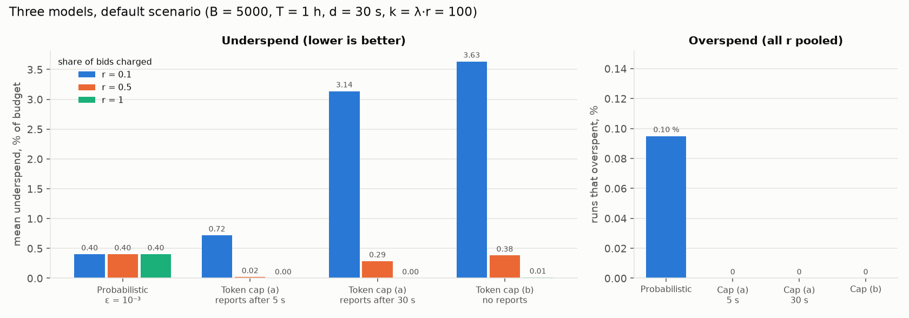
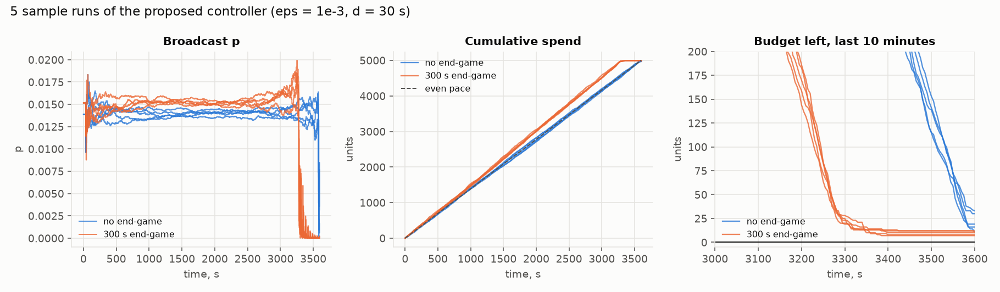

# budget-pacing-models

A center has a fixed budget to spend over a fixed time. It controls spending only
through a probability p that it sends to an unknown number of clients. Spend shows
up in the budget after a delay. The goal is to spend as much of the budget as
possible without overspending.

Problem statement and clarifications: [INITIALMODEL.MD](INITIALMODEL.MD).

## Models

| File | What it describes | Overspend | Results |
|---|---|---|---|
| [models/system.md](models/system.md) | The shared system: actors, how a bid turns into spend, formal model, why Poisson, whether tokens and the number of clients are needed | — | — |
| [models/probabilistic.md](models/probabilistic.md) | Probabilistic controller: Bayesian estimate of the spend rate, even pacing, and a risk budget ε | probability ≤ ε | [results/probabilistic.md](results/probabilistic.md) |
| [models/token-cap-a.md](models/token-cap-a.md) | Token cap with failure reports: tokens used ≤ B + failures reported | impossible | [results/token-cap-a.md](results/token-cap-a.md) |
| [models/token-cap-b.md](models/token-cap-b.md) | Token cap with no reports from clients: grants expire after one step, and the budget shows what they cost | impossible, if the delay d is a hard maximum | [results/token-cap-b.md](results/token-cap-b.md) |

The results files are generated by the experiment scripts and hold the full
tables. Each model file summarises its own results.

### The models side by side



The default scenario (B = 5000, T = 1 h, d = 30 s), with r, the share of bids
that are charged, varied while the spend rate k = λ·r stays at 100. The
probabilistic controller has the same small underspend for every r and
overspends in about ε = 0.1 % of runs. The token caps never overspend, but when
most bids are not charged (r = 0.1) they leave more budget unspent, and more
the later the center learns about failures; at r = 1 they cost nothing. Table:
[results/overview.md](results/overview.md).

## Implementation

- [IMPLEMENTATION.md](IMPLEMENTATION.md): how the spend rate k is estimated, how
  the pace is calculated, and how to compute the special functions without a
  numerics library.
- Elixir math kernel (Lanczos ln Γ, incomplete beta and gamma functions):
  [elixir/pacing_math.ex](elixir/pacing_math.ex), and the same in C as a NIF,
  [elixir/c_src/pacing_math_nif.c](elixir/c_src/pacing_math_nif.c).
- Python simulation and controllers: `src/pacing/`. Tests: `tests/`.

### Sample runs of the probabilistic controller



Five simulated campaigns of the probabilistic model
([models/probabilistic.md](models/probabilistic.md)), ε = 10⁻³, d = 30 s; blue
without an end-game, orange with a 300 s end-game. Left: the broadcast p, noisy
while k is still being learned, then near the even-pace value and rising at the
end. Middle: cumulative spend follows the dashed even-pace line. Right: the last
10 minutes — the budget left approaches zero but stays above it; the small
remainder is the price of the 30 s delay.

## Running

```bash
uv run pytest                          # Python tests, ~7 s
uv run python -m pacing.experiments    # probabilistic controller, ~10 min (--quick: ~45 s)
uv run python -m pacing.backstop       # token cap, versions (a) and (b), ~5 min (--quick: ~30 s)
uv run python -m pacing.overview       # README comparison chart, ~20 s
make -C elixir test                    # Elixir math + NIF (builds the NIF), 126 scipy cases
make -C elixir bench                   # pure Elixir vs NIF speed
```
