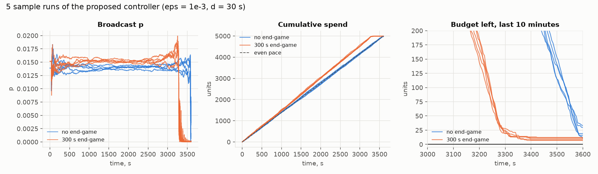

# budget-pacing-models

A center has a fixed budget to spend over a fixed time. It controls spending only
through a probability p that it sends to an unknown number of clients. Spend shows
up in the budget after a delay. The goal is to spend as much of the budget as
possible while keeping the chance of overspending at or below a chosen ε.

- Problem statement: [INITIALMODEL.MD](INITIALMODEL.MD)
- Model, strategy and why the guarantee holds: [MODEL.md](MODEL.md)
- Simulation results: [results/summary.md](results/summary.md)



## Quick start

```bash
uv run pytest                          # tests
uv run python -m pacing.experiments    # Monte Carlo experiments (--quick for a short run)
```
