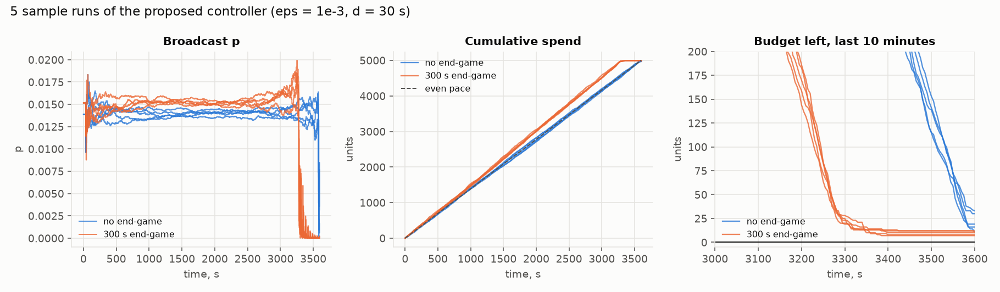
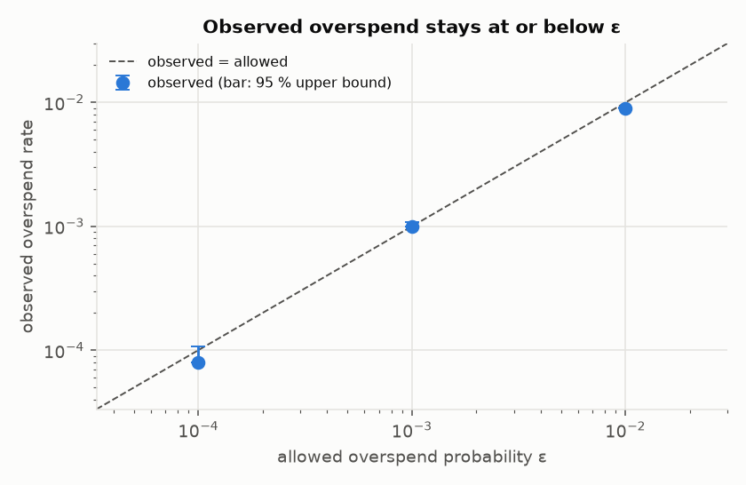
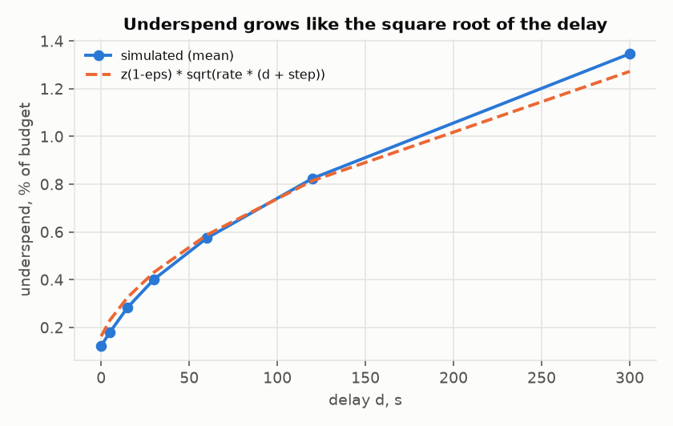
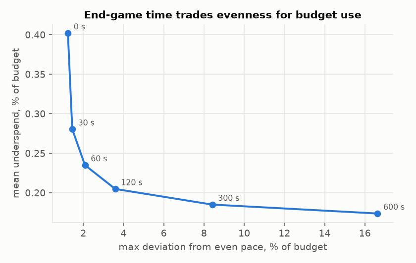
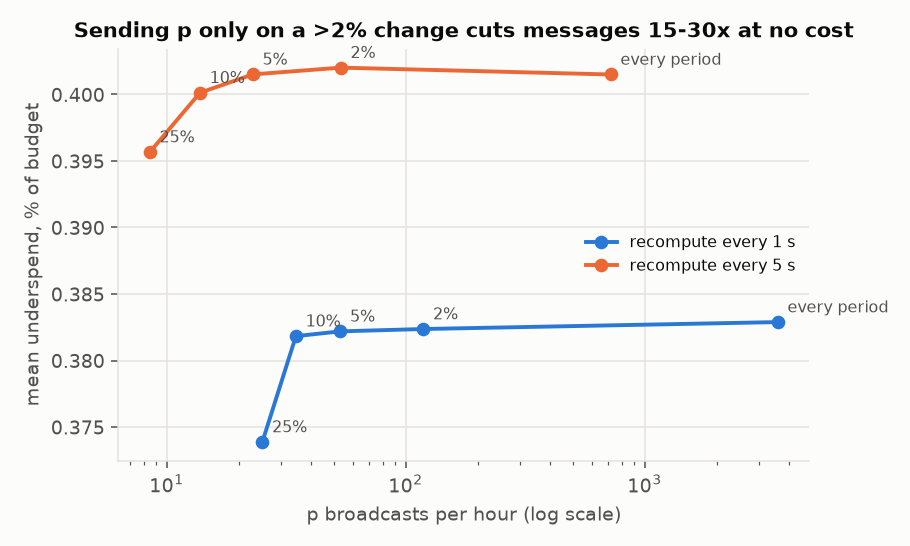
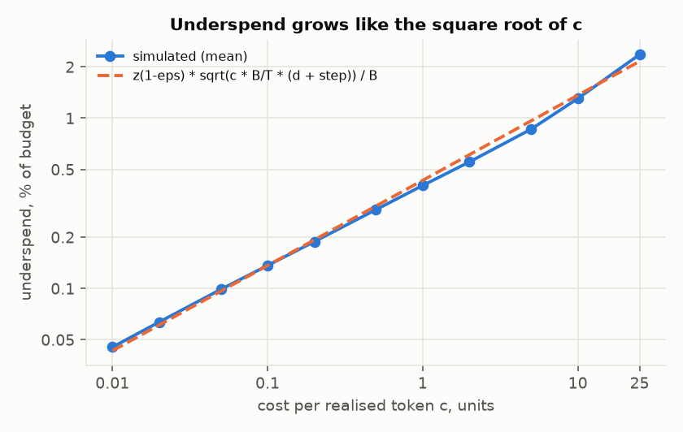

# Probabilistic controller (risk budget)

The center's strategy that keeps P(overspend) ≤ ε while spending as much of the
budget as possible, using only the budget it sees. It builds on
[system.md](system.md) (configuration, formal model, symbols). How k is
estimated and how the pace is calculated is explained in
[implementation.md](implementation.md) §1–2.

Code: `src/pacing/controllers.py` (`BayesRiskController`), Elixir port
[`elixir/pacing_controller.ex`](../elixir/pacing_controller.ex) · simulation:
`src/pacing/model.py` · results: [results/probabilistic.md](../results/probabilistic.md)
(`uv run python -m pacing.experiments`).

## 1. Strategy (`BayesRiskController`)

**Counting in spends.** A realised token costs c budget units
([system.md](system.md) §2), so the controller counts spends: the budget holds
B/c of them, and S_obs/c of them are visible. In the formulas below, B and S_obs
are these counts. With c = 1, the default, they are the budget units.

**What the center knows at time t** ([system.md](system.md) §2):

- **S_obs**: the spend visible in the budget, everything up to t − d.
- **E**, the *exposure* behind S_obs: E = ∫ p ds over the same period, up to
  t − d. It counts seconds at full throttle: p = 0.014 for 570 s gives
  E ≈ 8 s. The center knows E exactly, because it set p itself. So k ≈ S_obs / E.
- **W**, the *in-flight exposure*: ∫ p ds over the last d seconds, whose spend
  has happened but is not visible yet. The risk check uses it.

(With a delivery delay of p, the split point moves back by ceil(δ_max/Δ)
periods: [system.md](system.md) §6.)

At every control step:

1. **Estimate k.** k is estimated as a whole distribution, the posterior
   k ~ Gamma(α, β), not as a single number. The data alone say: likelihood of
   k ∝ k^S_obs · e^(−k·E).
   - **Once spend is visible (S_obs > 0 and E > 0):** α = 1 + S_obs, β = E.
     This is the *flat prior* posterior. A flat prior gives every value of k the
     same weight, so the estimate comes from the data only, and the center's
     initial guess cannot bias it. Its mean is about S_obs / E. Its upper tail
     equals the exact (Garwood) upper confidence bound for a Poisson rate, so
     the risk check never understates how large k could be. (The usual update
     Gamma(a₀ + S_obs, b₀ + E) would keep the guess forever; a guess 5× too low
     then overspent 2.6 % of runs against ε = 2 %.)
   - **Before that:** the data say nothing yet, so α and β come from the
     center's rough guess `prior_mean`, weighted as `prior_shape` = 2 spends.

   Pacing (step 2) uses the mean, k̂ = α/β. The risk check (step 3) uses the
   whole distribution. Details: [implementation.md §1](implementation.md#1-how-k-is-estimated).

   *Garwood bound.* The standard exact confidence bound for a Poisson rate
   (Garwood, 1936). After n events in exposure E, the upper bound at level 1 − α
   is the rate u at which seeing n or fewer events has probability α:
   u = Gamma⁻¹(1 − α; shape n + 1) / E. It never understates the rate,
   unlike the shortcut mean + z·√mean: with n = 100 at 99.9 % the shortcut gives
   130.9 and the exact bound 134.9; with n = 0 the shortcut gives 0 and the exact
   bound 3.0 at 95 % (the "rule of three"). The flat-prior posterior
   Gamma(1 + n, E) has exactly these quantiles.
2. **Pace.** Spend the expected remaining budget evenly over the remaining planning time:

       p_pace = (B − S_obs − k̂·W) / (k̂ · (T − endgame − t)),    clipped to [0, 1]

   `endgame` is optional (0 by default). With it, pacing aims to finish the
   planned spend `endgame` seconds before T. In the remaining time pacing asks
   for everything left, so the risk check (step 3) alone sets p and creeps up to
   B in small steps. This leaves less budget unspent at T, at the cost of less
   even spending (§3, item 4). Details:
   [implementation.md §2](implementation.md#2-how-the-pace-is-calculated) and
   [the end-game](implementation.md#the-end-game).

3. **Check the risk and cap p.** Pacing says how fast the center *wants* to
   spend. This step asks how fast it *may* spend, and lowers p if needed.

   **The danger.** The budget left on the books is B − S_obs. But some spend is
   already committed and not visible yet: the spend in flight (exposure W), plus
   whatever the next period adds (exposure p·Δ). If that hidden spend turns out
   larger than B − S_obs, the campaign overspends, and nothing can undo it.

   **The probability of that.** The hidden spend is random. For a known k it is
   Poisson with mean k·(W + p·Δ). The center does not know k exactly, so it
   averages over its Gamma distribution of k from step 1. The result is a
   negative-binomial distribution, whose tail has a closed formula (an
   incomplete beta function). Two tail probabilities are computed:

   - **q₀ = P(spend in flight > B − S_obs).** The risk already locked in by past
     decisions. Nothing can change it now, not even p = 0.
   - **q₁(p) = P(spend in flight + next period's spend > B − S_obs).** The risk
     if the next period runs at p. It grows with p, and q₁(0) = q₀.

   The difference q₁(p) − q₀ is the risk that *this decision* adds.

   **The risk budget.** The center may add risk, but only ε in total over the
   whole campaign. ε works like a second budget, counted in probability instead
   of money, and **risk_used** is its ledger: the running sum of the risk added
   by all decisions so far. It starts at 0, only grows, and never exceeds ε, so
   ε − risk_used is the allowance still left. For most of the campaign it stays
   practically 0; it grows near the end and typically finishes just under ε
   (for example 0.00097 with ε = 0.001). In one step the center may spend only a
   share of what is left:

       q₁(p) − q₀  ≤  η_Δ · (ε − risk_used)

   - If p_pace satisfies this, use p = p_pace.
   - If not, use the largest p that does (found by bisection, since q₁ grows
     with p).
   - Then add q₁(p) − q₀ to risk_used.

   Because the sum of all added risks never exceeds ε, the probability of
   overspend over the whole campaign is at most ε (§2).

   **Example** (ε = 10⁻³, default numbers, near the end). The budget shows
   S_obs = 4930, so 70 units are left. About 42 units are in flight. Then
   q₀ ≈ 3·10⁻⁵: the in-flight spend alone exceeding 70 is very unlikely. Suppose
   risk_used = 2·10⁻⁴, so this step may add at most 0.5 × (10⁻³ − 2·10⁻⁴) =
   4·10⁻⁴. Pacing asks for p = 0.0139, which would bring the expected hidden
   spend to 49 units and add a risk of 1.9·10⁻³: too much. The largest p that
   adds only 4·10⁻⁴ is p ≈ 0.0082 (46 units expected), so that is what the
   center sends.

   **When the check matters.** For most of the campaign B − S_obs is far larger
   than anything in flight, both tails are practically zero, and p = p_pace.
   The check starts to bind only near the end, when the budget left becomes
   comparable to the spend in flight. From then on p shrinks step by step.

   **The share η.** Spending the whole remaining risk budget in one step would
   leave nothing for later steps, so each step may use only a share. η is the
   share of the unused risk budget that may be used **per 5 seconds** (0.5 by
   default), so one step of length Δ may use η_Δ = 1 − (1 − η)^(Δ/5 s). Defining
   it per unit of time keeps the behaviour the same when Δ changes. (An earlier
   version applied η per *step*; with a short Δ it used up its risk budget
   faster in real time and stopped too early, so Δ = 1 s did worse than Δ = 5 s.)
4. **Send or keep** (only if a broadcast threshold is set). If the new p is within
   the threshold of the p that clients already use, *and* that old p also passes
   the risk check in step 3, keep the old p and send nothing. Otherwise send the
   new p. The risk is always charged for the p that clients actually use, so the
   guarantee below does not change.

## 2. Why this bounds total overspend by ε

Let Cᵢ be the committed spend after step i, and Fᵢ what the center knows when it
chooses pᵢ. Spend only goes up, so overspend happens at exactly one first step,
and

    P(overspend) = Σᵢ P(Cᵢ > B, Cᵢ₋₁ ≤ B) = Σᵢ E[ P(Cᵢ > B | Fᵢ) − P(Cᵢ₋₁ > B | Fᵢ) ].

Each bracket is exactly the q₁ − q₀ that the controller charges. The charges add up
to at most ε on every path, so P(overspend) ≤ ε. This is exact when k really is
drawn from the prior (`test_bayes_guarantee_holds_when_rate_is_drawn_from_prior`).

For a fixed but unknown k (the real case), the flat-prior posterior has an upper
tail equal to the exact Garwood confidence bound. In simulation it stays at or
below ε even when the initial guess is wrong by 10× in either direction. This part
is verified empirically, not proved.

**Why the charge is the difference q₁ − q₀, not q₁.** At a step, q₀ is the risk
carried over from earlier decisions; it was charged when they were made. q₁
includes it. Only q₁ − q₀ is new: the extra risk from choosing p instead of
stopping. Charging the whole q₁ would count the carried risk again at every
step. For example, with q₁ = 2·10⁻⁴ at one step and q₀ ≈ 2·10⁻⁴, q₁ = 3·10⁻⁴ at
the next, charging q₁ gives 5·10⁻⁴, while the true risk so far is 3·10⁻⁴; the
differences give 2·10⁻⁴ + 1·10⁻⁴ = 3·10⁻⁴. Over hundreds of steps the double
counting would use up ε at once, and the controller would stop far too early.

One subtlety: q₀ at a step is not literally the q₁ of the step before, because
new spend has become visible in between and the center recalculates. Good news
lowers q₀, bad news raises it. On average the two are equal, because the old q₁
was already the best prediction of the new q₀. That is why the formula has an
expectation, and why charging the differences is exact, not an approximation.

**Why checking ε at each step is not enough.** If you check
"P(in-flight > remaining) ≤ ε" at every step, as a fixed-reserve rule does, the
risk adds up over the last steps of the campaign. In the comparison below, that rule
overspends 2.6× more often than ε.

## 3. Results (default: B = 5000, T = 1 h, k = 100/s, d = 30 s, Δ = 5 s, ε = 10⁻³)

Full tables: [results/probabilistic.md](../results/probabilistic.md).

| strategy | P(overspend) | mean underspend | max deviation from even pace |
|---|---|---|---|
| Naive (stops when the visible budget is empty) | **1.0** (≈ 43 units over) | 0 % | 1.5 % |
| Fixed reserve, ε checked per step | 2.6·10⁻³ (> ε) | 0.35 % | 1.2 % |
| **Proposed** | **1.0·10⁻³** (400k runs: 9.97·10⁻⁴) | **0.40 %** | 1.2 % |
| Proposed + 300 s end-game | 0.8·10⁻³ | 0.19 % | 8.4 % |
| Oracle that knows k exactly | 1.05·10⁻³ | 0.40 % | 1.2 % |

What the results show:

1. **Not knowing k costs almost nothing.** The proposed controller matches the
   oracle. Learning k is not the hard part; the delay is.
2. **The underspend is set by delay noise.** With even pacing, the shortfall is
   about z₁₋ε·√(rate·(d+Δ)), where rate = B/T. It grows with
   the square root of the delay and the spend rate, so as a share of the budget it
   *falls* as B grows (~1/√B).

   

3. **A smaller ε is cheap.** Going from ε = 10⁻³ to 10⁻⁶ raises the underspend
   from 0.40 % to 0.57 %.

   

4. **Evenness versus budget use is a policy choice (point 5).** Finishing the
   planned spend a little early and then creeping up to B with a small p halves
   the underspend. A 30–60 s end-game already gets most of the gain for a small
   loss of evenness. How the end-game works and why it helps:
   [implementation.md](implementation.md#the-end-game).

   

5. **The initial guess of k matters only during the first d seconds**, when the
   center has no data yet. A 10× too-low guess makes spending uneven at the start
   (8.8 % deviation) but does not raise the overspend risk.
6. η (how fast the risk budget is used) hardly matters between 0.25 and 0.5.
7. **How often p is updated matters little while Δ is well below d.** With d = 30 s:

   | Δ | 1 s | 2 s | 5 s | 10 s | 30 s |
   |---|---|---|---|---|---|
   | mean underspend | 0.38 % | 0.39 % | 0.40 % | 0.42 % | 0.49 % |

   This follows the in-flight window d + Δ under the square root (item 2).
   Updating faster than about d/6 gains almost nothing.
8. **p does not need to be sent every period.** p stays almost flat for most of
   the campaign, so sending it only when it changes by more than 2–10 % cuts the
   messages to clients from 720 per hour (Δ = 5 s) to 14–53 per hour. Underspend
   and overspend stay the same. The cost is somewhat less even spending: the
   deviation from even pace goes from 1.2 % to 1.3–2.2 %. Recomputing every second
   but sending only on a > 5 % change gives the lowest underspend with about
   50 messages per hour.

   

9. **This controller cannot make overspend impossible**, only rare. A very small
   ε is cheap: 0.67 % underspend at ε = 10⁻⁹ and 0.78 % at ε = 10⁻¹². For
   certainty, see the token caps ([token-cap-a.md](token-cap-a.md),
   [token-cap-b.md](token-cap-b.md)).
10. **Underspend grows like √c, the cost of one spend.** With B = 5000 units
    fixed, a realised token costing c units means B/c spends. The fewer and
    larger the spends, the noisier the spend relative to B, and the larger the
    reserve for in-flight spend: about z·√(c·(B/T)·(d + Δ)) units. The request
    rate is scaled as λ = 1000/c, so the needed p stays ≈ 0.014. With λ fixed, any
    c below 0.014 could not spend B even at p = 1.

    | c (units per spend) | 0.01 | 0.05 | 0.1 | 0.5 | 1 | 5 | 10 | 25 |
    |---|---|---|---|---|---|---|---|---|
    | spends in the budget, B/c | 500 000 | 100 000 | 50 000 | 10 000 | 5000 | 1000 | 500 | 200 |
    | mean underspend | 0.045 % | 0.10 % | 0.14 % | 0.29 % | 0.40 % | 0.86 % | 1.30 % | 2.36 % |

    So what matters is the number of spends in the budget, not its size in
    money. Small spends make the delay almost free: at c = 0.01 only 0.045 % of
    the budget is left. The overspend rate stays at or below about ε for every c
    (0.35–1.3·10⁻³ at ε = 10⁻³ in 40 000 runs; the highest, at c = 25 with only
    200 spends, is about two standard errors above ε). The controller itself does
    not change: it divides the budget and the visible spend by c and counts spends.

    
11. **A delivery delay of p must be planned for.** If a new p reaches the
    clients δ seconds after the center decides it (a broker, or clients that
    poll), the center plans with a bound δ_max and widens its in-flight window by
    ceil(δ_max/Δ) periods ([system.md](system.md) §6, *Push or pull*). Default
    scenario, ε = 10⁻³, 40 000 runs per row:

    | δ (true) | 0 | 0.5 s | 2 s | 5 s | 10 s | 30 s |
    |---|---|---|---|---|---|---|
    | planned for (δ_max = δ): overspend | 1.0·10⁻³ | 0 | 0.5·10⁻⁴ | 1.0·10⁻³ | 0.95·10⁻³ | 0.5·10⁻⁴ |
    | planned for: mean underspend | 0.40 % | 0.57 % | 0.53 % | 0.45 % | 0.50 % | 0.84 % |
    | ignored (δ_max = 0): overspend | | | | **2.3·10⁻²** | **1.3·10⁻¹** | **5.1·10⁻¹** |

    Ignoring even a 1 s delay doubles the overspend rate (2.1·10⁻³); a 5 s delay
    makes it 23 times ε. Planned for, overspend stays at or below ε.

    The cost is not smooth in δ, because the window grows in whole periods.
    - **δ much shorter than a period costs most within its band.** At δ = 0.5 s
      the window already grows by a full 5 s period, so about 4.5 s of exposure
      is counted both as visible and as in flight: 0.57 % against 0.45 % at
      δ = 5 s, where the extra period fits exactly.
    - **A large δ costs more than the in-flight noise alone.** At δ = 30 s,
      0.84 % against 0.59 % from the noise. The controller's corrections,
      including the final creep towards B, also reach the clients 30 s late.

    
12. **A delivery delay far larger than planned is a runaway; three defences stop
    it.** With δ = 2 min and δ_max = 0, every run overspends, on average by
    9,700 units (about 2 × B): the controller reads the long silence as a tiny k
    and pushes p to 1 ([system.md](system.md) §6). Default scenario, ε = 10⁻³,
    40 000 runs per row:

    | δ = 2 min, unplanned | runs that overspend | worst overspend | underspend |
    |---|---|---|---|
    | no defence | 100 % | 10,383 units | 0 % |
    | age check (clients ignore p older than 1 s) | 0 | 0 | 100 % (stopped) |
    | halt when the measured delay exceeds plan | 0 | 0 | 99.7 % (stopped) |
    | rise limit ×2 per d | 50 % | 534 units (11 % of B) | 0.06 % |
    | rise limit ×1.5 per d | 63 % | 61 units (1.2 % of B) | 0.07 % |
    | rise limit ×1.5 + halt | 0 | 0 | 99.7 % (stopped) |

    The age check and the halt stop the campaign and leave the decision to an
    operator. The rise limit keeps it running and bounds the damage without
    preventing overspend. When nothing is wrong, a rise limit of ×1.5 costs
    nothing measurable: 0.40 % underspend as without it, and 0.38 % with a 10×
    too low initial guess of k.

## 4. Limits

- **Optimality.** The controller is greedy for each step. It is not the solution
  of the full dynamic programme. It does match the known-k oracle, and the
  remaining gap is the delay noise that any steadily-pacing strategy has.
  Solving the dynamic programme for the final phase of the campaign would tell
  how much more is possible.
- **Sensitivity to the traffic model.** The ε guarantee assumes Poisson traffic
  and a fixed delay ([system.md](system.md) §3 and §7).
