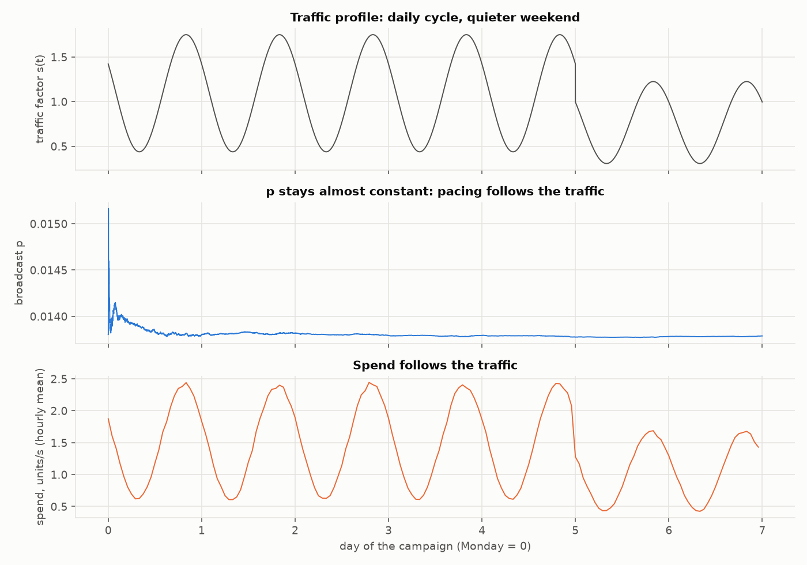

# Probabilistic controller for traffic that varies

The probabilistic controller ([../probabilistic.md](../probabilistic.md)),
extended for a request rate that follows the time of day and the day of the
week ([system.md](system.md)). Everything not mentioned here is as in the base
model: the estimate of k, the risk budget ε, the proof.

Code: `SeasonalController` in `src/pacing/seasonal.py` · results:
[results/seasonal/probabilistic.md](../../results/seasonal/probabilistic.md).

## 1. What changes, depending on what the center knows

### With the traffic profile known

The center has the shape s(t) from history and learns only the level k₀. Three
changes, each the constant-traffic formula with time replaced by traffic:

1. **Exposure is weighted by the traffic.** One second at p counts as
   p · s(t) seconds of average traffic:

       E = ∫ p · s du  (visible period),     W = ∫ p · s du  (last d seconds)

   The estimate of the level is the same Gamma posterior, k₀ ~ Gamma(1 + S_obs, E).
2. **Pacing spreads the budget over the remaining traffic**, not the remaining
   time:

       p_pace = (B − S_obs − k̂₀·W) / (k̂₀ · ∫ₜᵀ s(u) du)

   With the profile right this p is constant, and spend follows the traffic.
3. **The risk check charges the next step for its traffic:** p · Δ · s(t)
   instead of p · Δ.

Because spend is still Poisson with a known intensity, the guarantee is exact as
before ([system.md](system.md) §3).

### With the profile unknown

The center assumes constant traffic and estimates one k from all data so far:
the long-run average. For **pacing** that is fine: with a roughly constant p,
spend follows the traffic by itself. For the **risk check** it is not: at the
end, the risk check needs the spend that is in flight *now*, and the long-run
average is wrong whenever the traffic now is above or below it. If the campaign
ends in a busy hour, the controller reserves too little.

The fix: **two estimates of k.** Pacing keeps the long-run one. The risk check
uses only recent data: spend and exposure are discounted with a half-life
(`risk_half_life`, 1 hour by default in the experiments), so its estimate of k
follows the current traffic. The posterior is still a Gamma distribution, just
with fewer effective observations, so it is wider: an honest statement that
recent data are fewer.

### With a wrong profile

The center weights its exposure and plans by a shape that does not match.
Pacing is then uneven against the real traffic, and the risk check misjudges the
current rate in the same way as with no profile, or worse. A short memory for
the risk check helps here too, but only partly (§2).

## 2. Results

A 30-day campaign starting on a Monday, B = 3.6 million units, ε = 1 %, 4,000
runs per row. The campaign ends at midnight on a Wednesday, while traffic is
still high (factor 1.42).

| What the center knows | Overspend rate | Max deviation from the traffic target | Mean underspend |
|---|---|---|---|
| constant traffic (reference) | 0.9 % | 0.05 % | 28 units |
| **profile known** | **0.8 %** | **0.05 %** | 33 units |
| profile unknown | **14.7 %** | 0.57 % | 3 units |
| **profile unknown, risk check on the last 1 h** | **0.18 %** | 0.57 % | 11 units |
| profile unknown, risk check on the last 10 min | 0.6 % | 0.57 % | 9 units |
| profile wrong (peak at 16:00, no weekend dip) | **23.6 %** | 1.12 % | 1 unit |
| profile wrong, risk check on the last 1 h | 5.4 % | 1.12 % | 4 units |
| ends at 08:00 (low traffic), profile known | 1.0 % | 0.05 % | 17 units |
| ends at 08:00, profile unknown | 0 | 0.53 % | 971 units |

What the results show:

1. **A known profile keeps everything:** overspend within ε, spend within 0.05 %
   of the traffic-following target, and the same tiny underspend as with
   constant traffic. The chart shows p staying flat while spend rises and falls
   with the traffic.
2. **Without the profile, the risk check is the problem, not pacing.** Pacing
   follows the traffic well enough (0.57 % deviation), but a risk check based on
   the long-run k overspends in 15 % of campaigns when the campaign ends at a
   busy hour. It reserves for average traffic while the traffic is 1.4 times
   that.
3. **A risk check on recent data fixes it:** 0.18 % with the last hour. A shorter
   memory (10 min) also works, but its estimate is noisier.
4. **A wrong profile is worse than none** (24 %): it misjudges the current
   traffic *and* plans wrongly. A short-memory risk check reduces this to 5.4 %,
   still above ε. If the profile may be wrong, it is safer to drop it.
5. **When the campaign ends matters without a profile.** Ending at a quiet hour
   errs the other way: no overspend, but 971 units unspent, because the
   controller reserves for average traffic that is no longer there.
6. **Over a month, underspend is negligible** in every case (at most 0.03 % of
   B): with millions of spends the noise of the spend in flight is tiny
   compared with the budget. What matters is overspend and evenness.

## 3. Recommendation

- **Use the profile from history** when it is reliable: exact guarantee, best
  evenness.
- **Without a reliable profile, assume constant traffic and give the risk check
  a short memory** (about an hour). Pacing still follows the traffic, and the
  guarantee holds.
- **Never trust a profile you cannot check:** a wrong one breaks the guarantee
  more than having none.
- **Possible next step:** learn the profile during the campaign (for example
  hour-of-week factors from the first weeks), and use it once the data support
  it.

## 4. What is not modelled

- Traffic that changes in ways no profile captures (holidays, outages of the
  traffic source, sudden campaigns). The short-memory risk check helps with
  those too, but no experiment here measures it.
- The Elixir port: `PacingController` does not yet have the profile options.
