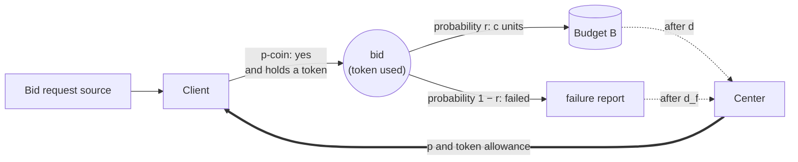
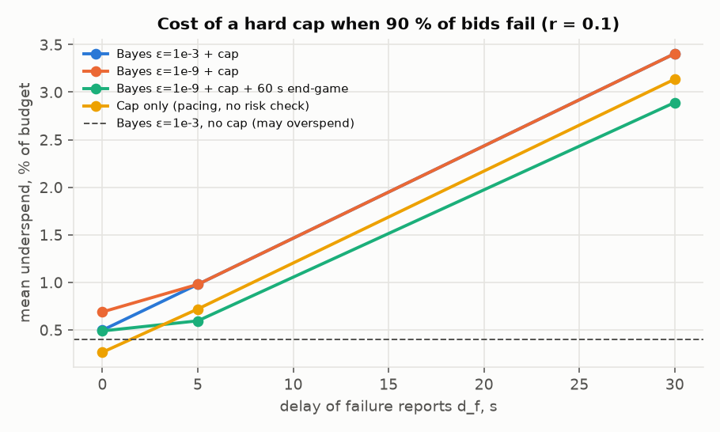

# Token cap, version (a): failure reports

A hard cap that makes overspend impossible. It builds on
[system.md](system.md) (configuration, formal model). The probabilistic
controller ([probabilistic.md](probabilistic.md)) keeps the chance of overspend
at or below ε, but it cannot reach zero: spend becomes visible only after the
delay d, and a Poisson burst has no upper limit. This file describes the cap
with failure reports, why it works, and what it costs. The version without
client reports is in [token-cap-b.md](token-cap-b.md).

Code: `src/pacing/backstop.py` (`mode="reports"`) · tests: `tests/test_backstop.py`
· results: [results/token-cap-a.md](../results/token-cap-a.md),
`results/token-cap-a.png` (`uv run python -m pacing.backstop`).

**Units.** A realised token costs c budget units ([system.md](system.md) §2).
All formulas below count in **spends**, not budget units: B stands for B/c, the
number of spends the budget can pay for (rounded down), and S_obs for the visible
spend divided by c. With c = 1, the default, the two are the same.

## 1. Idea

The controller has to *guess* how much spend is in flight, because the budget
shows spend only d seconds after it happens. The cap removes the guess. Every
bid needs a **token**, and the center counts tokens **when it grants them**. The
center then always knows an upper bound on everything that can still be
charged: each granted token costs at most c units. If granted tokens never exceed
what the budget can pay for, overspend cannot happen, whatever the traffic, the
delay, the controller or a lost message does.

The price: a token whose bid will fail still holds budget until the center knows
it failed. When many bids fail and that takes long, the held budget cannot be
spent at the end of the campaign.

There are two versions. They differ in how the center learns that a granted
token can no longer cost anything:

| | **(a) Failure reports** (this file) | **(b) No reports from clients** ([token-cap-b.md](token-cap-b.md)) |
|---|---|---|
| Center counts | tokens used, failures reported | only tokens it granted; they expire after one control step |
| Allowance | A = B + F_obs − U | A = B − S_obs − (tokens granted in the last d seconds) |
| Clients report | failures (after d_f), tokens used, blocked bids | nothing |
| Guarantee holds if | failure reports are truthful; late reports are safe | the spend delay d is never exceeded |
| Cost driven by | failure-report delay d_f | spend delay d, and how many tokens are granted |

## 2. Configuration

Compared with [system.md](system.md) §1, the actors are the same. Only the client's rule and
the messages change.

| | Without the cap (system.md) | With the cap |
|---|---|---|
| Client bids when | the p-coin says yes | the p-coin says yes **and** it holds a token. The token is used up. |
| Center → clients | p, broadcast | p, broadcast, plus a **token allowance** |
| Clients → center | nothing | **failure reports** (a used token was not charged), after delay d_f, and the number of **blocked bids** |
| Budget → center | spend, after delay d | spend, after delay d (no longer needed for safety) |

Life of a bid with the cap:

1. A request reaches a client, chosen at random.
2. The client flips its p-coin. On "no" the request is dropped, as before.
3. On "yes" the client needs a token. If none is left, the bid is **blocked**,
   and the client counts it.
4. With a token, the client bids and the token is used up.
5. With probability r the bid is charged c units, which appear in the budget
   after d. Otherwise it fails, and the client reports the failure to the center
   after d_f.

## 3. The center's rule and why it guarantees B

The center keeps two counters:

- **U**: tokens used so far. The center knows U exactly, because it granted
  them and clients report blocked bids.
- **F_obs**: failures reported so far.

At the start of every control step it sets the allowance for that step:

    A = B + F_obs − U

Clients together may use at most A tokens during the step. In the simulation the
allowance is one shared pool; §6 covers real wallets.

**Proof.** Every spend comes from a used token that did not fail. Let F_total be
all failures, reported or not. Counting in spends,

    spends = U − F_total ≤ U − F_obs ≤ B,

because F_obs ≤ F_total, and the allowance rule keeps U ≤ B + F_obs at all
times. ∎

The proof uses no probability, no Poisson assumption and no delay d. It holds
when traffic is bursty, when the delay runs long, when a stop message is lost,
and when the controller misbehaves. The tests check it with a controller that
always bids at p = 1 (`test_cap_makes_overspend_impossible_even_at_full_throttle`).

What it does need:
- clients cannot bid without a token, which is an enforcement point on the client;
- a token's bid costs at most c units (with varying prices, c is the highest one);
- failure reports are never false. A late report is safe: it only holds budget
  longer.

## 4. Where the cost comes from

At any moment the allowance equals

    A = (B − true spend) − (failures not yet reported)

so the budget the cap holds back is exactly the **unreported failures**. If
tokens are used at rate u, about (1 − r)·u·d_f′ failures are unreported at any
time. Here d_f′ is the failure-report delay plus half a control step, because
reports arrive at step boundaries.

**End of the campaign.** With even pacing, spend runs at ρ = B/T, so tokens are
used at u = ρ/r. The cap starts to bind once the remaining budget falls to the
unreported failures,

    x₀ = (1 − r)·ρ·d_f′ / r.

After that, the remaining budget can shrink only as fast as failures are
reported, so it decays exponentially with time constant

    τ = (1 − r)·d_f′ / r.

At pace ρ the cap starts to bind x₀/ρ = τ before T, so at T the unspent budget
is about x₀·e⁻¹. As a share of the budget:

    underspend ≈ (1 − r) · d_f′ / (e · r · T)

| r | d_f | rule of thumb | simulated (cap + plain pacing) |
|---|---|---|---|
| 1.0 | any | 0 % | 0.00 % |
| 0.5 | 0 s | 0.03 % | 0.00 % |
| 0.5 | 5 s | 0.08 % | 0.02 % |
| 0.5 | 30 s | 0.33 % | 0.29 % |
| 0.1 | 0 s | 0.23 % | 0.26 % |
| 0.1 | 5 s | 0.69 % | 0.72 % |
| 0.1 | 30 s | 2.99 % | 3.14 % |

(Control step Δ = 5 s, so d_f′ = d_f rounded up to whole steps, plus 2.5 s.)

What the formula shows:
- **The share of failing bids matters most**, through (1 − r)/r. At r = 1 the
  cost is zero: a token is the spend.
- **Failure reports should be fast.** The cost is proportional to d_f′. The
  spend delay d does not appear at all.
- **Budget size and traffic do not matter.** The cost as a share of the budget
  does not depend on B or λ. The probabilistic controller's cost, by contrast,
  falls like 1/√B ([probabilistic.md](probabilistic.md) §3, item 2). So for large budgets with slow
  failure reports, the probabilistic controller can be the cheaper of the two.
- **Longer campaigns help.** The cost falls like 1/T.
- **Slowing down at the end helps.** A lower pace just before T means fewer
  unreported failures when the budget runs out. That is why the 60 s end-game
  improves the cap's cost (§5).

## 5. Simulation results

Default scenario: B = 5000, T = 3600 s, d = 30 s, Δ = 5 s. k = λ·r = 100 is held
fixed while r varies, so the spend process is the same in every row. 20,000 runs
per row, mean budget left unspent; full table in [results/token-cap-a.md](../results/token-cap-a.md).

| r | d_f | Bayes ε = 10⁻³, no cap | Bayes ε = 10⁻³ + cap | Cap only | Bayes ε = 10⁻⁹ + cap + 60 s end-game |
|---|---|---|---|---|---|
| 1.0 | 30 s | 0.40 % (19 overspends) | 0.40 % | **0.00 %** | 0.49 % |
| 0.5 | 5 s | 0.40 % (18 overspends) | 0.40 % | **0.02 %** | 0.49 % |
| 0.5 | 30 s | same | 0.52 % | **0.29 %** | 0.49 % |
| 0.1 | 0 s | 0.40 % (16 overspends) | 0.50 % | **0.26 %** | 0.49 % |
| 0.1 | 5 s | same | 0.98 % | 0.72 % | **0.60 %** |
| 0.1 | 30 s | same | 3.40 % | 3.14 % | **2.89 %** |

"Cap only" means plain pacing (`NaiveController`) with the cap and no risk
check. **Every row with the cap had zero overspends.**

Observations:

1. **With a cap, the risk check is not needed for safety, and stacking it costs
   extra.** Each mechanism stops spending on its own terms, so "Bayes + cap" is
   never better than "cap only" with the same pacing.
2. **Cap only is the best design when the cap is cheap:** r ≥ 0.5, or failures
   reported within a few seconds. It also beats the probabilistic controller
   (0.40 %), which on top of that still allows overspend.
3. **When the cap is expensive (r = 0.1, d_f = 30 s), slowing down at the end is
   what helps**, not the risk check: the end-game brings 3.14 % down to 2.89 %.
   A longer end-game, or tapering the pace into the end, would help more.
4. **Evenness.** The cap blocks bids only near the end, so spending stays even:
   1.2–1.5 % maximum deviation, or 2.1 % with the deliberate 60 s end-game. The
   exception is r = 0.1 with d_f = 30 s (3.1–3.4 %), where blocking starts about
   τ ≈ 5 minutes before T.

## 6. Simulation details and simplifications

Each control step:

1. The controller picks p from what it sees (visible spend, its exposure, the
   in-flight window), exactly as in [probabilistic.md](probabilistic.md).
2. Clients want to make `wanted ~ Poisson(λ·p·Δ)` bids.
3. The cap allows `tokens = min(wanted, A)`. The rest are blocked.
4. Charged bids: `x ~ Binomial(tokens, r)`. They appear in the budget after d.
   Failures (`tokens − x`) are reported after d_f.
5. **Exposure correction.** Clients report blocked bids, so the center records
   the exposure that actually happened, p·Δ·tokens/wanted, not p·Δ. Without
   this, blocked bids would look like a low spend rate and drag k̂ down.

Simplifications:

- **One shared token pool.** In reality tokens sit in each client's wallet. A
  client may hold tokens it doesn't use while another is blocked. With leases of
  L tokens to N clients, up to about N·L tokens can be held when the budget runs
  out, and that budget is lost. Keep leases small near the end: shrink L as the
  allowance falls, and let unused tokens expire after a short lease time.
- **Allowance per control step.** A real implementation can refill continuously.
  Δ enters only through d_f′.
- **Failure reports are exact**, with a fixed delay. A random delay makes the cap
  hold budget longer but keeps it safe.
- **Steady traffic, as in [system.md](system.md).** Unlike the probabilistic guarantee, the
  cap's guarantee does not depend on this. Only its cost does.

Choosing between versions (a) and (b), and recommendations:
[token-cap-b.md](token-cap-b.md) §6.
