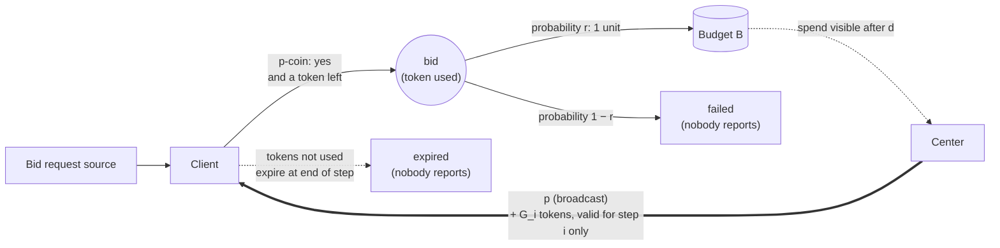
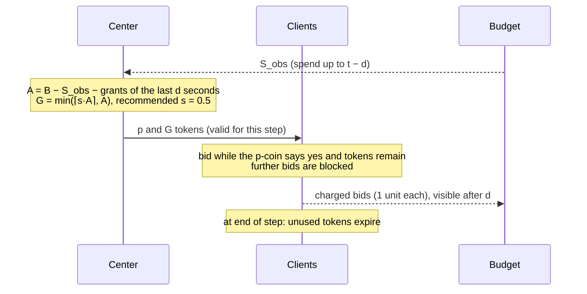

# Token cap, version (b): no reports from clients

Version (a) ([token-cap-a.md](token-cap-a.md)) needs clients to report
failures, tokens used and blocked bids.
Version (b) needs **nothing from clients**. It uses only what the center already
has: the tokens it granted, and the budget.

It builds on [system.md](system.md) and on the idea and cost analysis of
[token-cap-a.md](token-cap-a.md) §1 and §4.

Code: `src/pacing/backstop.py` (`mode="grants"`) · tests: `tests/test_backstop.py`
· results: [results/token-cap-b.md](../results/token-cap-b.md)
(`uv run python -m pacing.backstop`).

## 1. Schema

**What flows where.** Compare [token-cap-a.md](token-cap-a.md) §2. There are no arrows from clients back to the
center: the only feedback is the budget.



**How the center counts at the start of step i** (d = 30 s, Δ = 5 s, so the
window holds 6 steps):

```
 time ─────────────────────────────────────────────────────────────────────────►

 steps     … G(i-9)  G(i-8)  G(i-7) │ G(i-6)  G(i-5)  G(i-4)  G(i-3)  G(i-2)  G(i-1) │  G(i)
                                    │                                                │
           ◄── older than d ──────► │ ◄──────────── last d seconds ────────────────► │  now
           spend already visible:   │ spend not visible yet:                         │  new grant,
           counted in S_obs at      │ counted at the FULL grant, as if every token   │  at most A(i)
           ACTUAL cost (used,       │ were used and charged                          │
           charged tokens only)     │                                                │

 A(i) = B − S_obs − [ G(i-6) + G(i-5) + G(i-4) + G(i-3) + G(i-2) + G(i-1) ]
```

Each step, the oldest grant leaves the window. Its spend is now in the budget,
so it is counted at its actual cost instead of its full grant. Tokens that
expired unused or whose bids failed simply stop counting. This is where budget
is freed, with no message from clients.

**One control step:**



## 2. Rule

At the start of each control step i the center grants G_i tokens, **valid only
during that step**. Unused tokens expire. It never grants more than

    A_i = B − S_obs − (tokens granted in the last d seconds)

where S_obs is the spend visible in the budget, as in [system.md](system.md).

**Proof.** The spend delay d is fixed (answer A in [INITIALMODEL.MD](../INITIALMODEL.MD)). So the spend from
every step older than d is already in S_obs, and the only spend not yet visible
comes from the steps of the last d seconds. Each of those steps spent at most
the tokens it was granted. Hence

    total spend ≤ S_obs + (tokens granted in the last d seconds) + G_i ≤ B. ∎

Tokens that expired unused or whose bids failed need no report. Once their step
is older than d, the budget shows what they actually cost, and the center stops
counting them.

## 3. What (b) gives up

- **Its guarantee depends on the delay.** If a charge ever reaches the budget
  later than d, the proof breaks. Version (a) has no such assumption: a late
  failure report only holds budget longer. So use (b) only if d is a hard
  maximum, such as a guaranteed settlement time, not a typical delay.
- **The center must choose how many tokens to grant.** It does not see demand
  (bids per step), and it cannot compute it from k̂, because it knows only
  k = λ·r, not λ.
  - Grant too few, and bids are blocked while budget is still free.
  - Grant too many, and unused grants hold budget for d seconds.
- **Blocked bids are invisible.** Without blocked-bid counts the center cannot
  correct its exposure, so blocking looks like a lower k. This affects only the
  end of the campaign, when the cap binds.

## 4. Grant rules simulated

- **Share s** (needs no information): G_i = ⌈s·A_i⌉. Early on A_i is large, so the
  grants are far above demand and cost nothing. Near the end they shrink with
  the free budget.
- **Headroom h** (needs demand, for example from usage counts):
  G_i = min(A_i, ⌈h·λ·p·Δ⌉).

Grant share s, plain pacing with the cap, mean underspend (maximum pacing deviation):

| r | s = 0.14 | 0.29 | 0.43 | **0.57** | 0.71 | 0.86 |
|---|---|---|---|---|---|---|
| 0.1 | 6.2 % (6.2) | 4.4 % (4.4) | 3.8 % (3.8) | 3.5 % (3.5) | 3.2 % (3.3) | 2.5 % (**6.7**) |
| 0.5 | 0.80 % (1.4) | 0.49 % (1.4) | 0.40 % (1.4) | 0.36 % (1.4) | 0.33 % (1.7) | 0.29 % (**4.5**) |
| 1.0 | 0.13 % (1.4) | 0.03 % (1.4) | 0.01 % (1.4) | 0.01 % (1.4) | 0.02 % (1.6) | 0.06 % (**3.9**) |

A larger share leaves less unspent, up to about s ≈ 0.6–0.7. Beyond that,
spending becomes bursty: one step takes almost all of the allowance, and the
next d seconds get almost nothing. **s = 0.5, "grant half of what is free", is a
good default.**

## 5. Results

Default scenario, 20,000 runs per row, plain pacing with the cap. Full table in
[results/token-cap-b.md](../results/token-cap-b.md).

| r | (b) share 0.5 | (b) share 0.5 + 60 s end-game | (b) headroom 1.5 | (a) failure reports, d_f = 30 s |
|---|---|---|---|---|
| 1.0 | 0.01 % | **0.00 %** | 0.03 % | **0.00 %** |
| 0.5 | 0.38 % | **0.13 %** | 0.32 % | 0.29 % |
| 0.1 | 3.63 % | 3.16 % | 3.17 % | 3.14 % |

**Zero overspends in every row.** The tests confirm this also for a controller
that always bids at p = 1, and for every grant rule.

What this shows:

1. **(b) costs about the same as (a) with failure reports delayed by d.** In (b)
   a token stays unresolved until its step is older than d, so the cost formula
   of [token-cap-a.md](token-cap-a.md) §4 applies with d_f′ = d + Δ/2: 2.99 % predicted vs 3.17 % simulated at
   r = 0.1. If clients could report failures faster than d, version (a) would be
   cheaper.
2. **Knowing demand helps little.** Share 0.5 needs no information and is within
   about 0.5 percentage points of headroom 1.5. That is the largest gap, at
   r = 0.1; at r ≥ 0.5 it is 0.06 points or less.
3. **When every bid is charged (r = 1), (b) is almost free** (0.01 %), and free
   with an end-game. With r = 1 a token *is* the spend, so (b) only has to wait
   d to see the spend of tokens granted.
4. **The end-game helps (b) the most at r = 0.5**: 0.38 % → 0.13 %.

## 6. Choosing between (a) and (b): recommendations

1. **If clients can be required to hold tokens, use the cap.** It is the only
   way to make overspend impossible rather than unlikely. It also protects
   against failures the statistics cannot: lost stop messages, misbehaving
   clients, delays longer than expected (version a).
2. **Choose the version by what you can trust:**
   - **(b), no client reports, grant share 0.5:** the simplest. Use it if the
     spend delay d is a hard maximum.
   - **(a), failure reports:** use it if delays can vary, or if failures can be
     reported much faster than d. Report a failure as soon as the bid's outcome
     is known, not when billing settles.
3. **Choose the pacing by the cap's expected cost, (1 − r)·d_f′ / (e·r·T)**, with
   d_f′ = d + Δ/2 for version (b):
   - small (under ~0.3 %): plain pacing plus the cap, with no risk check;
   - large: add an end-game or a taper, so less is unresolved at the end;
   - very large, for example a large budget with slow reports: the token-aware
     risk check below.
4. **Possible improvement: a token-aware risk check.** The cap holds back all
   unreported failures, but only a share 1 − r of unresolved tokens will fail,
   so the center can predict how many will. It could let the allowance exceed
   B + F_obs − U by an amount whose overspend risk is ε, using the
   Binomial(unresolved, r) distribution. This is much tighter than the Poisson
   in-flight estimate, because the token count is known. It gives up certainty
   again for ε, so it suits campaigns where ε is acceptable and the cap's cost
   is not.
