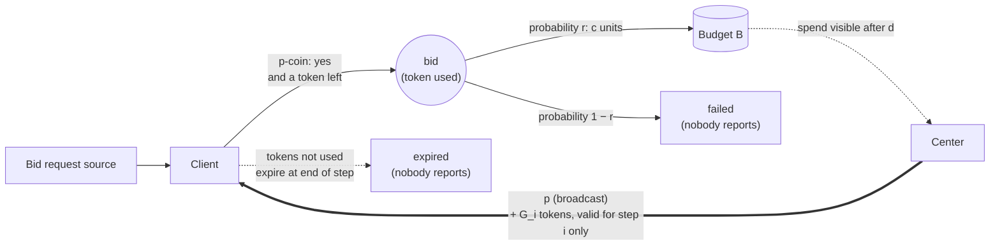
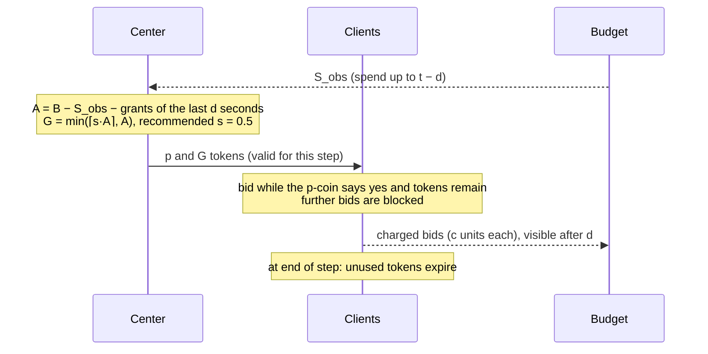
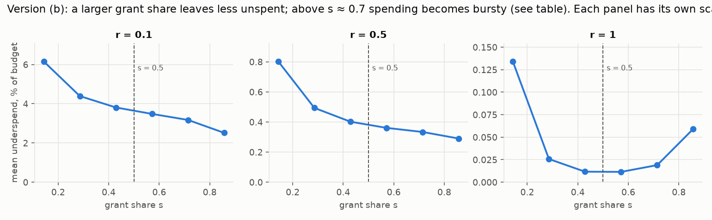
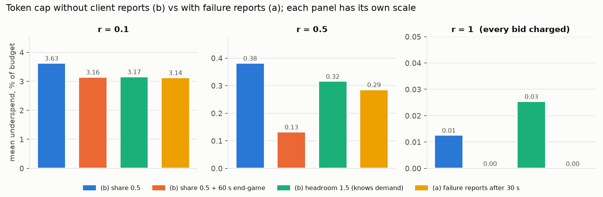

# Token cap, version (b): no reports from clients

Version (a) ([token-cap-a.md](token-cap-a.md)) needs clients to report
failures, tokens used and blocked bids.
Version (b) needs **nothing from clients**. It uses only what the center already
has: the tokens it granted, and the budget.

It builds on [system.md](system.md) and on the idea and cost analysis of
[token-cap-a.md](token-cap-a.md) §1 and §4.

Code: `src/pacing/backstop.py` (`mode="grants"`), Elixir `TokenCap.Grants` in
[`elixir/token_cap.ex`](../elixir/token_cap.ex) · tests: `tests/test_backstop.py`
· results: [results/token-cap-b.md](../results/token-cap-b.md)
(`uv run python -m pacing.backstop`).

**Units.** A realised token costs c budget units ([system.md](system.md) §2).
All formulas below count in **spends**, not budget units: B stands for B/c, the
number of spends the budget can pay for (rounded down), and S_obs for the visible
spend divided by c. With c = 1, the default, the two are the same.

## 1. How it works

### The idea in plain words

The center cannot see spend for d seconds after it happens. So it treats every
token it hands out as *possibly spent* until the budget proves otherwise:

1. **Tokens are permission to bid.** A client may bid only while it holds a
   token, and each bid uses one up.
2. **Tokens live for one control step.** At the start of each step the center
   grants a fresh batch; whatever is unused at the end of the step expires.
3. **A fresh grant counts as fully spent.** For the next d seconds the center
   assumes the worst: every granted token was used and charged.
4. **After d seconds the budget tells the truth.** By then all spend from that
   grant is visible. The center drops the grant from its count and relies on
   the budget instead. Tokens that expired or whose bids failed cost nothing,
   so that part of the budget is free again.

Nobody reports anything. A token that expired, or a bid that failed, simply
never shows up in the budget, and after d seconds the center knows.

### What the center does at the start of every step

The center keeps one list: the grants of the last d seconds (the *window*).
With d = 30 s and steps of 5 s, the window holds the last 6 grants.

1. **Read the budget:** S_obs, the spend visible now.
2. **Drop the oldest grant** from the window if it is older than d. Its spend
   is already inside S_obs.
3. **Compute the allowance**, the budget that is certainly still free:

       A = B − S_obs − (sum of the grants in the window)

4. **Choose the new grant G ≤ A.** The simple rule is a fixed share:
   G = ⌈s·A⌉ with s = 0.5, "grant half of what is free" (§4).
5. **Add G to the window** and send it to the clients together with p.

### What a client does

- **When a grant arrives:** it replaces whatever the client held; the old
  tokens are gone. The grant is usable until the end of the step.
- **For each bid request:** flip the p-coin as always. On "yes", bid only if a
  token is left, and use it up. With no token left, the bid is *blocked*.
- **At the end of the step:** unused tokens expire. The client reports nothing.

### When the client's tokens decrease

The client holds one number: the tokens left from its current grant, and the
time until which they are valid. That number goes **up** only when a grant
arrives. It goes **down** in exactly four cases:

| When | What happens | Why |
|---|---|---|
| **A bid is made** (the p-coin says yes and a token is left) | −1 | a bid needs a token; this is what limits spend |
| **The step ends** (the validity time runs out) | all remaining tokens become unusable | a grant is counted only for its own step; using it later would be spend the center no longer counts |
| **A new grant arrives** | the old tokens are dropped first, then the new grant is set | so no bid can take an old token under the new validity time |
| **A grant arrives too old** (age check) | it is ignored; the current tokens run out as above | an old grant may belong to a step that is already over |

Things that do **not** change the count:

- **A failed bid** keeps its token used. Nobody reports the failure; the budget
  simply never shows a charge for it, and after d seconds the center sees that
  its budget is free again (see the worked example below).
- **A blocked bid** (no token left) uses nothing.
- **The client never lowers its tokens by choice.** How many it gets is
  decided by the center: the grant is half of the budget that is certainly
  free, so near the end of the campaign the grants, and with them the client's
  tokens, shrink step by step.

**Timeline of one client in one step** (Δ = 5 s, margin 0.5 s):

```
 t = 0 s    grant of 25 arrives          tokens: 25   valid until 4.5 s
 t = 0.3 s  bid                           tokens: 24
 t = 0.9 s  p-coin says no                tokens: 24
 t = 1.4 s  bid (later fails)             tokens: 23   the token stays used
   …        22 more bids                  tokens: 1
 t = 4.1 s  bid                           tokens: 0
 t = 4.3 s  p-coin says yes, no token     tokens: 0    bid blocked
 t = 4.5 s  validity ends                 tokens: 0 usable
 t = 5.0 s  next grant of 13 arrives      tokens: 13   valid until 9.5 s
```

If the step had ended with tokens left, say 6, they would have become unusable
at 4.5 s and been dropped when the next grant arrived at 5.0 s.

### A worked example

B = 100 spends, the window holds 2 steps (d = 2Δ), share s = 0.5.

| step | S_obs (visible) | window (grants not yet proven) | allowance A | new grant G | what the clients then do |
|---|---|---|---|---|---|
| 1 | 0 | none | 100 − 0 − 0 = 100 | 50 | use 30 tokens, 12 are charged; 20 expire |
| 2 | 0 | 50 | 100 − 0 − 50 = 50 | 25 | use 25, 10 charged |
| 3 | 0 | 50, 25 | 100 − 0 − 75 = 25 | 13 | use 13, 5 charged |
| 4 | 12 | 25, 13 | 100 − 12 − 38 = 50 | 25 | use 20, 9 charged |
| 5 | 22 | 13, 25 | 100 − 22 − 38 = 40 | 20 | use 20, 7 charged |
| 6 | 27 | 25, 20 | 100 − 27 − 45 = 28 | 14 | … |

What to notice:

- **Steps 1–3: the allowance shrinks fast.** Nothing is visible yet, so every
  grant is held at its full size: 50, then 75 of the 100.
- **Step 4: budget comes back.** The grant of step 1 leaves the window. It was
  held as 50 but really cost 12, which is now in S_obs. So 38 spends are free
  again: the 20 tokens that expired and the 18 bids that failed. Nobody
  reported them; the budget showed it.
- **At every step** S_obs + window + G ≤ B. For example at step 4:
  12 + 38 + 25 = 75 ≤ 100. That inequality is the whole guarantee (§2).
- **The cost:** in steps 2 and 3 the center granted only 25 and 13, although
  far more budget was really free. Budget held by tokens that will never be
  charged is the price of needing no reports.

### Pictures

**What flows where.** Compare [token-cap-a.md](token-cap-a.md) §2. There are no
arrows from clients back to the center: the only feedback is the budget.



**How the center counts at the start of step i** (d = 30 s, Δ = 5 s, so the
window holds 6 steps):

```
 time ─────────────────────────────────────────────────────────────────────────►

 steps     … G(i-9)  G(i-8)  G(i-7) │ G(i-6)  G(i-5)  G(i-4)  G(i-3)  G(i-2)  G(i-1) │  G(i)
                                    │                                                │
           ◄── older than d ──────► │ ◄──────────── last d seconds ────────────────► │  now
           spend already visible:   │ spend not visible yet:                         │  new grant,
           counted in S_obs at      │ counted at the FULL grant, as if every token   │  at most A(i)
           ACTUAL cost (used,       │ were used and charged                          │
           charged tokens only)     │                                                │

 A(i) = B − S_obs − [ G(i-6) + G(i-5) + G(i-4) + G(i-3) + G(i-2) + G(i-1) ]
```

**One control step:**



## 2. Why overspend is impossible

**The rule.** At the start of each control step i the center grants G_i tokens,
valid only during that step, and never more than

    A_i = B − S_obs − (tokens granted in the last d seconds)

**The proof**, in three observations:

1. **Old steps are fully visible.** The spend delay is d (answer A in
   [initialmodel.md](initialmodel.md)), so all spend from steps older than d is
   already inside S_obs.
2. **Recent steps are bounded by their grants.** Spend not yet visible can come
   only from the steps of the last d seconds, and each of those steps spent at
   most the tokens it was granted, because a bid needs a token and unused
   tokens expired.
3. **The new step is bounded by its grant** G_i ≤ A_i.

Adding the three:

    total spend ≤ S_obs + (tokens granted in the last d seconds) + G_i ≤ B. ∎

The proof uses no probability and no assumption about traffic, p or the
controller. It needs exactly three things: no bid without a token, tokens that
really expire with their step, and a spend delay that never exceeds d (§3, §6).

## 3. What (b) gives up

- **Its guarantee depends on the delay.** If a charge ever reaches the budget
  later than d, the proof breaks. Version (a) has no such assumption: a late
  failure report only holds budget longer. So use (b) only if d is a hard
  maximum, such as a guaranteed settlement time, not a typical delay. If the
  delay varies, the grant window must be its longest possible value: with the
  mean as the window, most runs overspend when every bid is charged, and with a
  long tail the long window holds so much budget that underspend becomes very
  large ([system.md](system.md) §7, [results/token-cap-b.md](../results/token-cap-b.md)).
- **It also depends on how fast grants reach the clients.** A grant must be used
  within its own period. If it arrives up to δ_max late, the client may use it
  only for Δ − margin after it arrives, with margin ≥ δ_max, and δ_max must be
  shorter than Δ. Ignoring a 4 s delivery delay (Δ = 5 s) made 94 % of runs
  overspend when every bid is charged ([system.md](system.md) §6,
  [results/overview.md](../results/overview.md)). Planned for, it costs about
  0.1 point of underspend.
- **The center must choose how many tokens to grant.** It does not see demand
  (bids per step), and it cannot compute it from k̂, because it knows only
  k = λ·r, not λ.
  - Grant too few, and bids are blocked while budget is still free.
  - Grant too many, and unused grants hold budget for d seconds.
- **Blocked bids are invisible.** Without blocked-bid counts the center cannot
  correct its exposure, so blocking looks like a lower k. This affects only the
  end of the campaign, when the cap binds.

## 4. Grant rules simulated

- **Share s** (needs no information): G_i = ⌈s·A_i⌉. Early on A_i is large, so the
  grants are far above demand and cost nothing. Near the end they shrink with
  the free budget.
- **Headroom h** (needs demand, for example from usage counts):
  G_i = min(A_i, ⌈h·λ·p·Δ⌉).

Grant share s, plain pacing with the cap, mean underspend (maximum pacing deviation):

| r | s = 0.14 | 0.29 | 0.43 | **0.57** | 0.71 | 0.86 |
|---|---|---|---|---|---|---|
| 0.1 | 6.2 % (6.2) | 4.4 % (4.4) | 3.8 % (3.8) | 3.5 % (3.5) | 3.2 % (3.3) | 2.5 % (**6.7**) |
| 0.5 | 0.80 % (1.4) | 0.49 % (1.4) | 0.40 % (1.4) | 0.36 % (1.4) | 0.33 % (1.7) | 0.29 % (**4.5**) |
| 1.0 | 0.13 % (1.4) | 0.03 % (1.4) | 0.01 % (1.4) | 0.01 % (1.4) | 0.02 % (1.6) | 0.06 % (**3.9**) |

A larger share leaves less unspent, up to about s ≈ 0.6–0.7. Beyond that,
spending becomes bursty: one step takes almost all of the allowance, and the
next d seconds get almost nothing. **s = 0.5, "grant half of what is free", is a
good default.**



## 5. Results

Default scenario, 20,000 runs per row, plain pacing with the cap. Full table in
[results/token-cap-b.md](../results/token-cap-b.md). "60 s end-game": pacing plans
to finish the spend 60 s before T and then approaches B with a small p
([implementation.md](implementation.md#the-end-game)).

| r | (b) share 0.5 | (b) share 0.5 + 60 s end-game | (b) headroom 1.5 | (a) failure reports, d_f = 30 s |
|---|---|---|---|---|
| 1.0 | 0.01 % | **0.00 %** | 0.03 % | **0.00 %** |
| 0.5 | 0.38 % | **0.13 %** | 0.32 % | 0.29 % |
| 0.1 | 3.63 % | 3.16 % | 3.17 % | 3.14 % |



**Zero overspends in every row.** The tests confirm this also for a controller
that always bids at p = 1, and for every grant rule.

What this shows:

1. **(b) costs about the same as (a) with failure reports delayed by d.** In (b)
   a token stays unresolved until its step is older than d, so the cost formula
   of [token-cap-a.md](token-cap-a.md) §4 applies with d_f′ = d + Δ/2: 2.99 % predicted vs 3.17 % simulated at
   r = 0.1. If clients could report failures faster than d, version (a) would be
   cheaper.
2. **Knowing demand helps little.** Share 0.5 needs no information and is within
   about 0.5 percentage points of headroom 1.5. That is the largest gap, at
   r = 0.1; at r ≥ 0.5 it is 0.06 points or less.
3. **When every bid is charged (r = 1), (b) is almost free** (0.01 %), and free
   with an end-game. With r = 1 a token *is* the spend, so (b) only has to wait
   d to see the spend of tokens granted.
4. **The end-game helps (b) the most at r = 0.5**: 0.38 % → 0.13 %.

## 6. Lost connection between center and clients

Version (b) is safe through an outage only under conditions about time.

**Center → clients lost** (no p, no grants). No new grant arrives, so clients
stop when their current grant expires, within one period: the fastest stop of
all models.

**A clean reconnect is safe; a slow one is the danger.** Grants queued during
the outage arrive in a burst when the link returns. A client measures a grant's
validity from when it *arrives*, so a stale grant could in principle be used
after its period has ended. But each new grant *replaces* the one the client
holds, and the next one arrives at the start of the next period, so after a
clean reconnect a stale grant is used only within its own period. The danger
is a link that comes back slow, delivering every grant late for a while (a
backlog draining): then each grant runs into the next period, as spend the
center no longer counts. With a 4 s delay the center did not plan for, 94 % of
runs overspent when every bid is charged ([system.md](system.md) §6). Three
conditions keep (b) safe in every case:

1. the **age check** drops grants older than δ_max + clock skew, which needs
   clocks synchronised within a known skew;
2. the **grant margin is at least δ_max**, so a grant ends before its period;
3. the **spend delay d is a hard maximum**.

**Clients → center lost** (heartbeats). The center stops granting to a client
it does not hear from. Safe: the client simply stops.

**What an outage costs.** Nothing beyond the usual: grants expire, and their
spend shows in the budget after d, so the budget is fully usable again without
any report from the clients. The bids that would have reached cut-off clients
are lost; the controller raises p for the clients still connected.

| | (a) failure reports | (b) no reports |
|---|---|---|
| Overspend through any outage | impossible | impossible if age check + margin ≥ δ_max + hard d |
| Conditions | no bid without a token, honest reports, durable counts | the same durable state, plus synchronised clocks and timing bounds |
| How fast cut-off clients stop | when the wallet is empty or the lease expires | within one period |
| Budget lost to an outage | up to one wallet per client that never returns | none |
| Needs reports from clients | yes | no |

If overspend must be impossible through outages, use (a), with small wallets
near the end and a durable store. (b) is a good choice when clients cannot send
reports, provided their clocks are synchronised and the age check is on.

**Measured** (default scenario, plain pacing with the cap, grant share 0.5;
20,000 runs per row; full table in
[results/token-cap-b.md](../results/token-cap-b.md)): no run overspends in any
outage, including clients bidding at p = 1 through an outage that lasts to the
end. A clean outage costs only the bids that could not be made:

| underspend | no outage | 60 s from 3,300 s | 60 s from 3,500 s | from 3,300 s to the end | 300 s from 1,000 s |
|---|---|---|---|---|---|
| r = 0.1 | 3.63 % | 4.26 % | 4.26 % | 8.01 % | 3.10 % |
| r = 1 | 0.01 % | 0.01 % | 0.14 % | 7.57 % | 0.01 % |

The simulated reconnect is clean (grants arrive on time again at once); a slow
backlog is the delivery-delay case measured in [system.md](system.md) §6.

## 7. Choosing between (a) and (b): recommendations

1. **If clients can be required to hold tokens, use the cap.** It is the only
   way to make overspend impossible rather than unlikely. It also protects
   against failures the statistics cannot: lost stop messages, misbehaving
   clients, delays longer than expected (version a).
2. **Choose the version by what you can trust:**
   - **(b), no client reports, grant share 0.5:** the simplest. Use it if the
     spend delay d is a hard maximum.
   - **(a), failure reports:** use it if delays can vary, or if failures can be
     reported much faster than d. Report a failure as soon as the bid's outcome
     is known, not when billing settles.
3. **Choose the pacing by the cap's expected cost, (1 − r)·d_f′ / (e·r·T)**, with
   d_f′ = d + Δ/2 for version (b):
   - small (under ~0.3 %): plain pacing plus the cap, with no risk check;
   - large: add an end-game or a taper, so less is unresolved at the end;
   - very large, for example a large budget with slow reports: the token-aware
     risk check below.
4. **Possible improvement: a token-aware risk check.** The cap holds back all
   unreported failures, but only a share 1 − r of unresolved tokens will fail,
   so the center can predict how many will. It could let the allowance exceed
   B + F_obs − U by an amount whose overspend risk is ε, using the
   Binomial(unresolved, r) distribution. This is much tighter than the Poisson
   in-flight estimate, because the token count is known. It gives up certainty
   again for ε, so it suits campaigns where ε is acceptable and the cap's cost
   is not.
