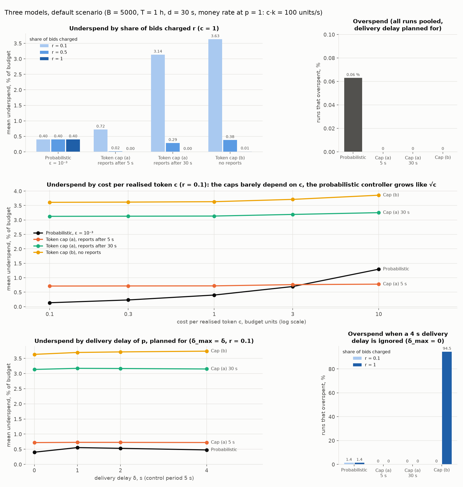

# Results: the three models side by side

Generated by `uv run python -m pacing.overview`. Default scenario (B = 5000, T = 3600 s, d = 30 s, step = 5 s). The money rate at p = 1 is kept at c·λ·r = 100 units/s while r (share of bids charged) and c (cost per realised token) vary, so the needed p stays ~0.014. 20000 runs per cell. Token-cap rows use plain pacing with the cap (*cap only* in the token-cap results). Details: [probabilistic](probabilistic.md), [token cap (a)](token-cap-a.md), [token cap (b)](token-cap-b.md).

## Mean underspend %, by share of bids charged r (c = 1)

| model | r = 0.1 | r = 0.5 | r = 1 |
|---|---|---|---|
| Probabilistic, ε = 10⁻³ | 0.40 | 0.40 | 0.40 |
| Token cap (a), reports after 5 s | 0.72 | 0.02 | 0.00 |
| Token cap (a), reports after 30 s | 3.14 | 0.29 | 0.00 |
| Token cap (b), no reports | 3.63 | 0.38 | 0.01 |

## Mean underspend %, by cost per realised token c (r = 0.1)

| model | c = 0.1 | c = 0.3 | c = 1 | c = 3 | c = 10 |
|---|---|---|---|---|---|
| Probabilistic, ε = 10⁻³ | 0.14 | 0.23 | 0.40 | 0.70 | 1.30 |
| Token cap (a), reports after 5 s | 0.71 | 0.72 | 0.72 | 0.76 | 0.78 |
| Token cap (a), reports after 30 s | 3.13 | 3.13 | 3.14 | 3.19 | 3.25 |
| Token cap (b), no reports | 3.61 | 3.62 | 3.63 | 3.71 | 3.86 |

## Mean underspend %, by delivery delay of p, planned for (δ_max = δ, r = 0.1)

A new p (and, in version (b), a grant) reaches the clients δ seconds after the center decides it. The probabilistic controller widens its in-flight window by ceil(δ_max/step) periods; version (b) uses each grant for step − δ_max after it arrives.

| model | δ = 0 s | δ = 1 s | δ = 2 s | δ = 4 s |
|---|---|---|---|---|
| Probabilistic, ε = 10⁻³ | 0.40 | 0.56 | 0.53 | 0.48 |
| Token cap (a), reports after 5 s | 0.72 | 0.73 | 0.73 | 0.72 |
| Token cap (a), reports after 30 s | 3.14 | 3.17 | 3.17 | 3.15 |
| Token cap (b), no reports | 3.63 | 3.70 | 3.71 | 3.74 |

## Overspends when a 4 s delivery delay is ignored (δ_max = 0)

| model | r = 0.1 | r = 1 |
|---|---|---|
| Probabilistic, ε = 10⁻³ | 272 / 20000 | 272 / 20000 |
| Token cap (a), reports after 5 s | 0 / 20000 | 0 / 20000 |
| Token cap (a), reports after 30 s | 0 / 20000 | 0 / 20000 |
| Token cap (b), no reports | 0 / 20000 | 18890 / 20000 |

## Overspends, all cells where the delivery delay is planned for, pooled

| model | overspends / runs |
|---|---|
| Probabilistic, ε = 10⁻³ | 126 / 200000 |
| Token cap (a), reports after 5 s | 0 / 200000 |
| Token cap (a), reports after 30 s | 0 / 200000 |
| Token cap (b), no reports | 0 / 200000 |

