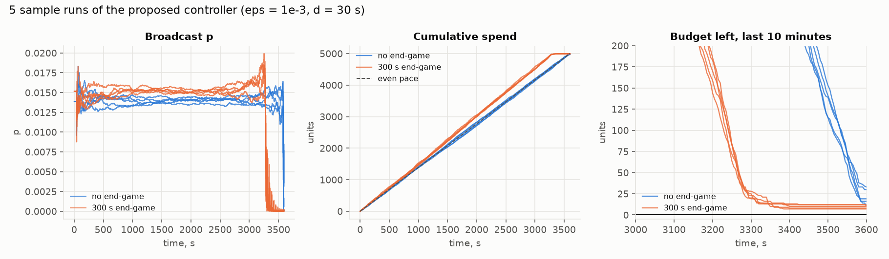
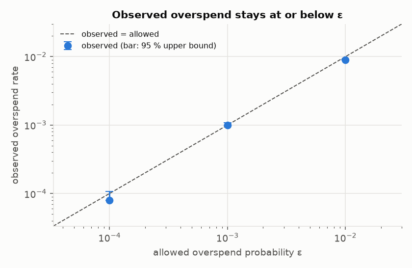
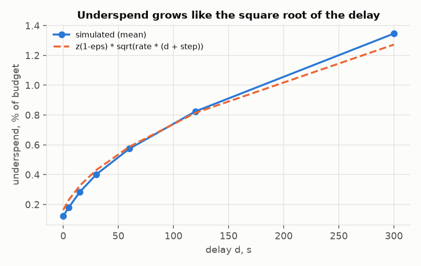
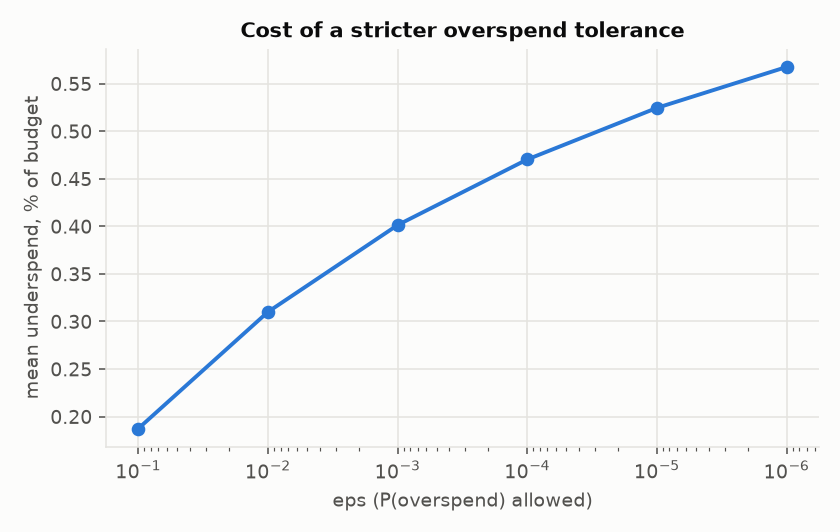
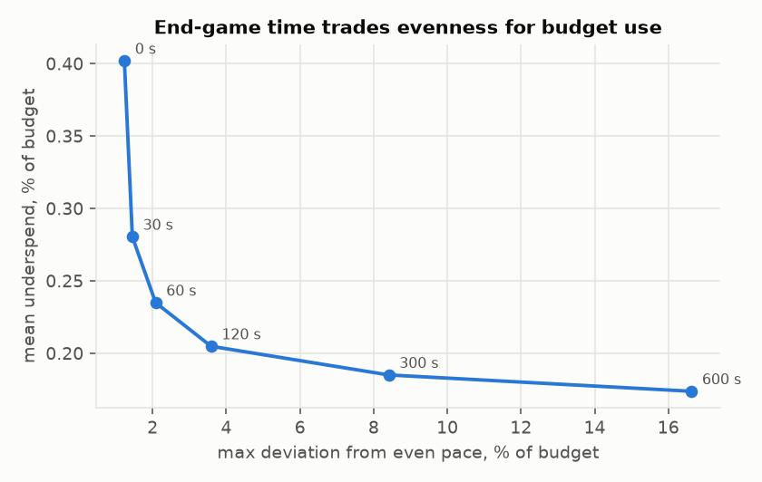
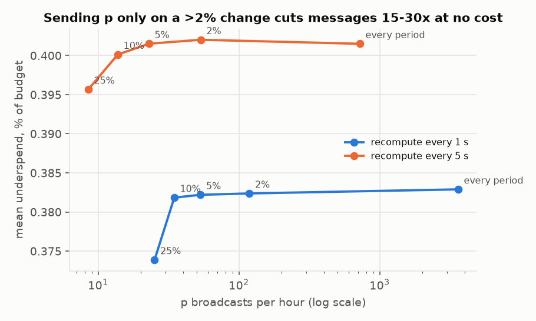
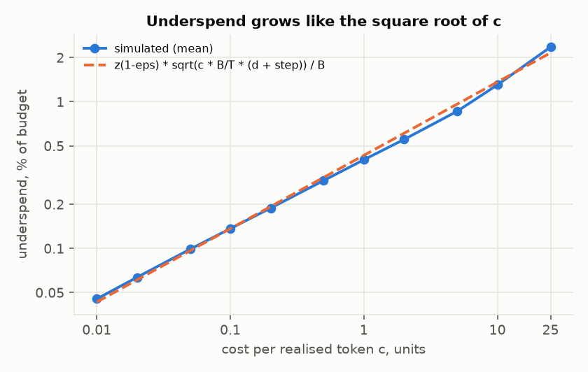
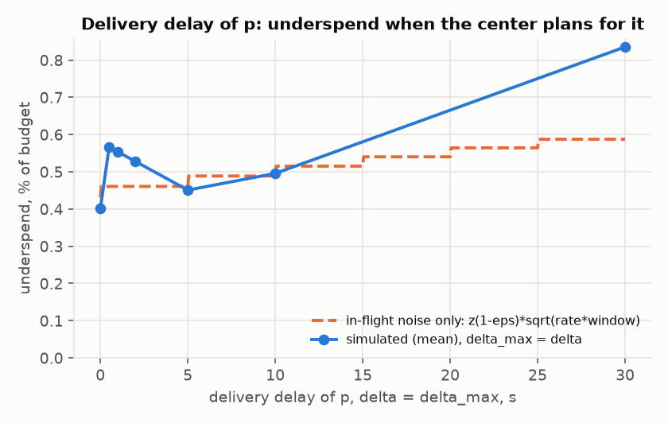

# Results: probabilistic controller

Model: [models/probabilistic.md](../models/probabilistic.md). Generated by `uv run python -m pacing.experiments`.

Default scenario: B = 5000 units, T = 3600 s, lambda = 1000 req/s, r = 0.1, d = 30 s, control step = 5 s, c = 1 budget unit per realised token. Needed p ~ 0.014. Overspend tolerance eps = 0.001. 40000 runs per row unless stated.

## 1. Strategies compared

| strategy | P(overspend) | 95% upper bound | mean overspend, units (if over) | mean underspend % | p95 underspend % | max pacing deviation % |
|---|---|---|---|---|---|---|
| Naive (ignores in-flight spend) | 1.00e+00 | 1.0e+00 | 43.1 | 0.000 | 0.000 | 1.49 |
| Plug-in reserve, eps checked per step | 2.60e-03 | 3.1e-03 | 2.5 | 0.347 | 0.560 | 1.23 |
| **Proposed: Bayes + risk budget** | 1.10e-03 | 1.4e-03 | 3.3 | 0.401 | 0.600 | 1.23 |
| Proposed + 300 s end-game | 8.25e-04 | 1.1e-03 | 2.7 | 0.185 | 0.260 | 8.41 |
| Oracle (knows lambda*r exactly) | 1.05e-03 | 1.4e-03 | 2.7 | 0.399 | 0.600 | 1.21 |

## 2. Overspend tolerance holds

Proposed controller, 400000 runs per row.

| strategy | P(overspend) | 95% upper bound | mean overspend, units (if over) | mean underspend % | p95 underspend % | max pacing deviation % |
|---|---|---|---|---|---|---|
| eps = 0.01 | 8.90e-03 | 9.1e-03 | 3.0 | 0.310 | 0.520 | 1.23 |
| eps = 0.001 | 9.97e-04 | 1.1e-03 | 2.7 | 0.402 | 0.600 | 1.23 |
| eps = 0.0001 | 8.00e-05 | 1.1e-04 | 2.4 | 0.471 | 0.680 | 1.23 |

## 3. Effect of the delay d

| strategy | P(overspend) | 95% upper bound | mean overspend, units (if over) | mean underspend % | p95 underspend % | max pacing deviation % |
|---|---|---|---|---|---|---|
| d = 0 s | 9.50e-04 | 1.2e-03 | 1.4 | 0.123 | 0.200 | 1.20 |
| d = 5 s | 8.00e-04 | 1.1e-03 | 1.8 | 0.180 | 0.280 | 1.20 |
| d = 15 s | 8.75e-04 | 1.2e-03 | 2.7 | 0.283 | 0.440 | 1.22 |
| d = 30 s | 9.50e-04 | 1.2e-03 | 2.6 | 0.401 | 0.600 | 1.23 |
| d = 60 s | 8.75e-04 | 1.2e-03 | 2.5 | 0.574 | 0.860 | 1.26 |
| d = 120 s | 1.12e-03 | 1.4e-03 | 6.0 | 0.824 | 1.260 | 1.34 |
| d = 300 s | 9.25e-04 | 1.2e-03 | 6.4 | 1.346 | 2.040 | 1.64 |

## 4. Effect of the overspend tolerance eps

| strategy | P(overspend) | 95% upper bound | mean overspend, units (if over) | mean underspend % | p95 underspend % | max pacing deviation % |
|---|---|---|---|---|---|---|
| eps = 0.1 | 8.44e-02 | 8.7e-02 | 3.8 | 0.187 | 0.400 | 1.23 |
| eps = 0.01 | 1.02e-02 | 1.1e-02 | 2.8 | 0.310 | 0.520 | 1.23 |
| eps = 0.001 | 1.10e-03 | 1.4e-03 | 2.6 | 0.401 | 0.600 | 1.23 |
| eps = 0.0001 | 5.00e-05 | 1.6e-04 | 1.5 | 0.470 | 0.680 | 1.23 |
| eps = 1e-05 | 0 | 7.5e-05 | 0.0 | 0.524 | 0.720 | 1.23 |
| eps = 1e-06 | 0 | 7.5e-05 | 0.0 | 0.567 | 0.760 | 1.23 |

## 5. End-game time: evenness vs underspend

| strategy | P(overspend) | 95% upper bound | mean overspend, units (if over) | mean underspend % | p95 underspend % | max pacing deviation % |
|---|---|---|---|---|---|---|
| end-game 0 s | 8.75e-04 | 1.2e-03 | 2.2 | 0.402 | 0.600 | 1.23 |
| end-game 30 s | 9.75e-04 | 1.3e-03 | 2.7 | 0.280 | 0.420 | 1.45 |
| end-game 60 s | 6.00e-04 | 8.4e-04 | 2.5 | 0.235 | 0.340 | 2.08 |
| end-game 120 s | 1.15e-03 | 1.5e-03 | 2.3 | 0.205 | 0.300 | 3.59 |
| end-game 300 s | 9.75e-04 | 1.3e-03 | 2.2 | 0.185 | 0.260 | 8.41 |
| end-game 600 s | 9.75e-04 | 1.3e-03 | 2.9 | 0.174 | 0.220 | 16.63 |

## 6. Wrong initial guess of lambda*r (true rate fixed)

| strategy | P(overspend) | 95% upper bound | mean overspend, units (if over) | mean underspend % | p95 underspend % | max pacing deviation % |
|---|---|---|---|---|---|---|
| guess = 0.1 x true | 1.12e-03 | 1.4e-03 | 2.5 | 0.381 | 0.580 | 8.84 |
| guess = 0.5 x true | 8.75e-04 | 1.2e-03 | 1.9 | 0.400 | 0.600 | 1.54 |
| guess = 2 x true | 1.18e-03 | 1.5e-03 | 2.8 | 0.402 | 0.620 | 1.36 |
| guess = 10 x true | 7.25e-04 | 9.9e-04 | 2.3 | 0.402 | 0.620 | 1.73 |

## 7. Risk-spending rate eta (share of the unused risk budget that may be used per 5 s)

| strategy | P(overspend) | 95% upper bound | mean overspend, units (if over) | mean underspend % | p95 underspend % | max pacing deviation % |
|---|---|---|---|---|---|---|
| eta = 0.1 | 4.25e-04 | 6.4e-04 | 2.4 | 0.412 | 0.620 | 1.23 |
| eta = 0.25 | 5.50e-04 | 7.9e-04 | 3.0 | 0.399 | 0.600 | 1.23 |
| eta = 0.5 | 8.75e-04 | 1.2e-03 | 2.9 | 0.402 | 0.600 | 1.23 |
| eta = 0.9 | 9.75e-04 | 1.3e-03 | 2.2 | 0.432 | 0.660 | 1.23 |
| eta = 1 | 1.08e-03 | 1.4e-03 | 2.5 | 0.443 | 0.680 | 1.23 |

## 8. Control period Δ (p recomputed and sent every Δ seconds)

| setting | P(overspend) | 95% upper bound | mean underspend % | p95 underspend % | max pacing deviation % | p broadcasts per hour |
|---|---|---|---|---|---|---|
| Δ = 1 s | 7.50e-04 | 1.0e-03 | 0.382 | 0.580 | 1.25 | 3600 |
| Δ = 2 s | 1.20e-03 | 1.5e-03 | 0.388 | 0.580 | 1.24 | 1800 |
| Δ = 5 s | 8.25e-04 | 1.1e-03 | 0.402 | 0.600 | 1.23 | 720 |
| Δ = 10 s | 9.75e-04 | 1.3e-03 | 0.424 | 0.640 | 1.22 | 360 |
| Δ = 30 s | 7.50e-04 | 1.0e-03 | 0.493 | 0.760 | 1.18 | 120 |

## 9. Send p only when it changes by more than a threshold

The center still recomputes p every Δ, but sends it only when the relative change exceeds the threshold (and keeps the old p only if that is still safe).

| setting | P(overspend) | 95% upper bound | mean underspend % | p95 underspend % | max pacing deviation % | p broadcasts per hour |
|---|---|---|---|---|---|---|
| Δ = 1 s, threshold every period | 1.30e-03 | 1.6e-03 | 0.383 | 0.580 | 1.25 | 3600 |
| Δ = 1 s, threshold 2% | 9.75e-04 | 1.3e-03 | 0.382 | 0.580 | 1.31 | 118 |
| Δ = 1 s, threshold 5% | 7.75e-04 | 1.0e-03 | 0.382 | 0.580 | 1.54 | 53 |
| Δ = 1 s, threshold 10% | 1.18e-03 | 1.5e-03 | 0.382 | 0.580 | 2.16 | 35 |
| Δ = 1 s, threshold 25% | 9.75e-04 | 1.3e-03 | 0.374 | 0.600 | 4.66 | 25 |
| Δ = 5 s, threshold every period | 6.00e-04 | 8.4e-04 | 0.402 | 0.620 | 1.23 | 720 |
| Δ = 5 s, threshold 2% | 1.12e-03 | 1.4e-03 | 0.402 | 0.600 | 1.29 | 53 |
| Δ = 5 s, threshold 5% | 1.10e-03 | 1.4e-03 | 0.402 | 0.600 | 1.53 | 23 |
| Δ = 5 s, threshold 10% | 1.15e-03 | 1.5e-03 | 0.400 | 0.620 | 2.15 | 14 |
| Δ = 5 s, threshold 25% | 1.15e-03 | 1.5e-03 | 0.396 | 0.620 | 3.49 | 8 |

## 10. Cost per realised token c

Spend = c x realised tokens. B = 5000 units and r stay fixed; lambda is scaled to 1000/c so the needed p stays ~ 0.014 (with lambda fixed, c < 0.014 could not spend B even at p = 1). Only the size of each spend changes: B/c spends of c units.

| strategy | P(overspend) | 95% upper bound | mean overspend, units (if over) | mean underspend % | p95 underspend % | max pacing deviation % |
|---|---|---|---|---|---|---|
| c = 0.01 (B/c = 500000 spends) | 5.50e-04 | 7.9e-04 | 0.2 | 0.045 | 0.068 | 0.12 |
| c = 0.02 (B/c = 250000 spends) | 4.25e-04 | 6.4e-04 | 0.2 | 0.063 | 0.095 | 0.17 |
| c = 0.05 (B/c = 100000 spends) | 3.50e-04 | 5.5e-04 | 0.7 | 0.099 | 0.147 | 0.28 |
| c = 0.1 (B/c = 50000 spends) | 4.50e-04 | 6.7e-04 | 0.7 | 0.136 | 0.204 | 0.39 |
| c = 0.2 (B/c = 25000 spends) | 8.25e-04 | 1.1e-03 | 0.9 | 0.188 | 0.284 | 0.55 |
| c = 0.5 (B/c = 10000 spends) | 1.18e-03 | 1.5e-03 | 2.0 | 0.290 | 0.440 | 0.87 |
| c = 1 (B/c = 5000 spends) | 1.05e-03 | 1.4e-03 | 2.4 | 0.402 | 0.600 | 1.23 |
| c = 2 (B/c = 2500 spends) | 1.10e-03 | 1.4e-03 | 4.2 | 0.553 | 0.840 | 1.74 |
| c = 5 (B/c = 1000 spends) | 8.50e-04 | 1.1e-03 | 8.4 | 0.861 | 1.300 | 2.76 |
| c = 10 (B/c = 500 spends) | 6.25e-04 | 8.7e-04 | 16.0 | 1.303 | 2.000 | 3.89 |
| c = 25 (B/c = 200 spends) | 1.33e-03 | 1.7e-03 | 29.7 | 2.361 | 3.500 | 6.17 |

## 11. Delivery delay of p

A new p reaches the clients delta seconds after the center decides it (a broker, or clients that poll). The center plans with a bound delta_max: its in-flight window is ceil(d/step) + ceil(delta_max/step) periods. First delta = delta_max, then delta_max = 0 although delta > 0 (the delay is ignored).

| strategy | P(overspend) | 95% upper bound | mean overspend, units (if over) | mean underspend % | p95 underspend % | max pacing deviation % |
|---|---|---|---|---|---|---|
| delta = delta_max = 0 s | 1.00e-03 | 1.3e-03 | 2.5 | 0.401 | 0.600 | 1.23 |
| delta = delta_max = 0.5 s | 0 | 7.5e-05 | 0.0 | 0.567 | 0.780 | 1.46 |
| delta = delta_max = 1 s | 2.50e-05 | 1.2e-04 | 2.0 | 0.553 | 0.780 | 1.43 |
| delta = delta_max = 2 s | 5.00e-05 | 1.6e-04 | 1.0 | 0.528 | 0.740 | 1.39 |
| delta = delta_max = 5 s | 1.00e-03 | 1.3e-03 | 3.0 | 0.451 | 0.680 | 1.26 |
| delta = delta_max = 10 s | 9.50e-04 | 1.2e-03 | 3.3 | 0.496 | 0.760 | 1.33 |
| delta = delta_max = 30 s | 5.00e-05 | 1.6e-04 | 4.0 | 0.835 | 1.220 | 1.79 |
|  |  |  |  |  |  |  |
| delta = 1 s, ignored (delta_max = 0) | 2.13e-03 | 2.5e-03 | 2.7 | 0.376 | 0.580 | 1.24 |
| delta = 5 s, ignored (delta_max = 0) | 2.26e-02 | 2.4e-02 | 3.4 | 0.278 | 0.500 | 1.64 |
| delta = 10 s, ignored (delta_max = 0) | 1.33e-01 | 1.4e-01 | 4.6 | 0.170 | 0.400 | 3.02 |
| delta = 30 s, ignored (delta_max = 0) | 5.09e-01 | 5.1e-01 | 8.2 | 0.068 | 0.300 | 19.23 |
| delta = 120 s, ignored (delta_max = 0) | 1.00e+00 | 1.0e+00 | 9702.3 | 0.000 | 0.000 | 283.51 |

## 12. Defences against an unplanned delivery delay (delta = 120 s, delta_max = 0)

Age check: clients ignore a p older than 1 s. Rise limit: p may grow by at most x2 (or x1.5) per d. Halt: the center measures the delay from heartbeats and sends p = 0 once it exceeds delta_max + 5 s. The last rows show the rise limit's cost when nothing is wrong.

| setting | P(overspend) | mean overspend, units (if over) | worst overspend, units | mean underspend % | max pacing deviation % |
|---|---|---|---|---|---|
| no defence | 1.00e+00 | 9703.6 | 10383 | 0.000 | 283.54 |
| age check (limit 1 s) | 0 | 0.0 | 0 | 100.000 | 100.00 |
| rise limit x2 per d | 4.99e-01 | 7.1 | 534 | 0.055 | 68.63 |
| rise limit x1.5 per d | 6.31e-01 | 13.6 | 61 | 0.068 | 26.64 |
| halt on measured delay | 0 | 0.0 | 0 | 99.722 | 99.72 |
| rise limit x1.5 + halt | 0 | 0.0 | 0 | 99.722 | 99.72 |
| no delay, rise limit x1.5 (cost) | 7.75e-04 | 2.5 | 8 | 0.402 | 1.22 |
| no delay, rise limit x1.5, guess 10x too low | 9.25e-04 | 2.7 | 9 | 0.382 | 8.84 |

_Total compute: 657 s._
