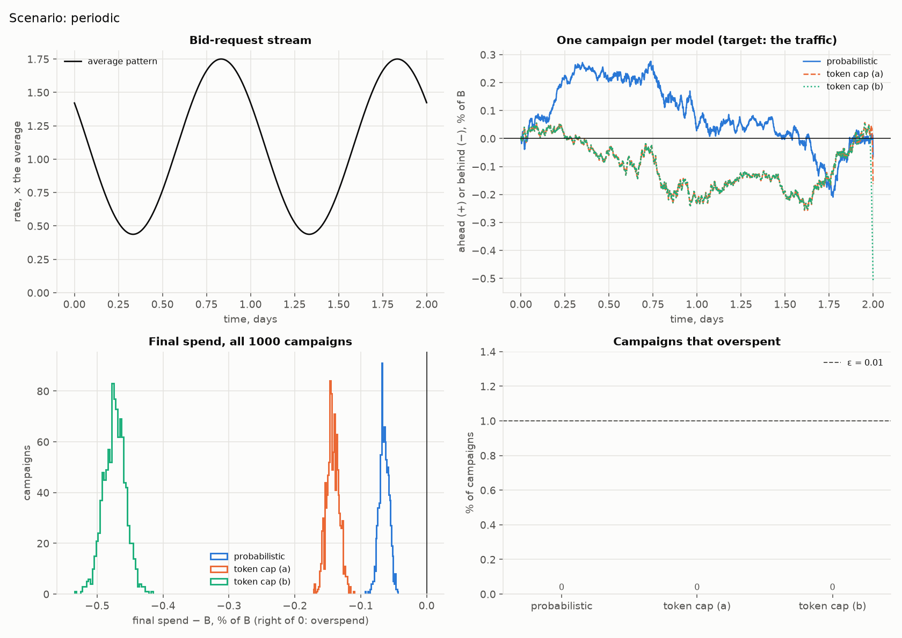

# Scenario: periodic

Generated by `uv run python -m pacing.scenario_file`. Model descriptions: [models/system.md](../../models/system.md).

## The scenario as simulated

- campaign: B = 168,000 units over 2 days, control period 60 s, pacing goal: follow the traffic
- traffic: λ = 1000 requests/s, charged share r = 0.1, stream: varies (periodic, trend or steps); the center's belief: the true profile
- spend delay: fixed 30 s; the center assumes 30 s
- delivery delay of p: 0 s (planned for 0 s)
- 1000 runs per model, seed 1

## Results

| model | P(overspend) | 95% upper bound | worst overspend, units | mean underspend, units | mean underspend % | p95 underspend % | max deviation from the target % | p messages per hour |
|---|---|---|---|---|---|---|---|---|
| probabilistic (ε = 0.01) | 0 | 3.0e-03 | 0 | 109 | 0.065 | 0.077 | 0.21 | 60.0 |
| token cap (a), failure reports after 0 s | 0 | 3.0e-03 | 0 | 240 | 0.143 | 0.158 | 0.22 | – |
| token cap (b), grant share 0.5 | 0 | 3.0e-03 | 0 | 797 | 0.474 | 0.501 | 0.47 | – |

*The charts:* top left, the bid-request stream (the average pattern, and one random sample if the traffic fluctuates). Top right, one simulated campaign per model: how far its spend so far is ahead of (+) or behind (−) the target, in % of B; the two token caps use the same pacing and the same random traffic, so their lines coincide until a cap binds near the end. Bottom left, the final spend of every simulated campaign minus B: right of 0 is overspend, left of 0 underspend. Bottom right, the share of campaigns that overspent, against ε.

**What the columns mean** (each value is over all simulated campaigns of that model):

| Column | Meaning |
|---|---|
| model | the model simulated, with its main setting |
| P(overspend) | share of campaigns whose total spend exceeded the budget B. For the probabilistic model it should be at most ε; for the token caps it should be 0 |
| 95% upper bound | the highest overspend probability still consistent with the runs (Clopper–Pearson, 95 %). With few runs, a P(overspend) of 0 does not mean the true probability is 0: this bound says how large it could be |
| worst overspend, units | the largest amount by which any campaign exceeded B, in budget units (0 if none did) |
| mean underspend, units | budget left unspent at the end, averaged over the campaigns |
| mean underspend % | the same, as a percentage of B |
| p95 underspend % | 95 % of the campaigns left at most this percentage of B unspent |
| max deviation from the target % | how far spending strayed from the target, as a percentage of B: the largest gap during the campaign, averaged over the campaigns. The target here is the traffic-following curve (the share of the campaign's traffic seen so far) |
| p messages per hour | how often the center sent a new p to the clients (probabilistic model only; – for the caps, whose pacing is not counted) |
