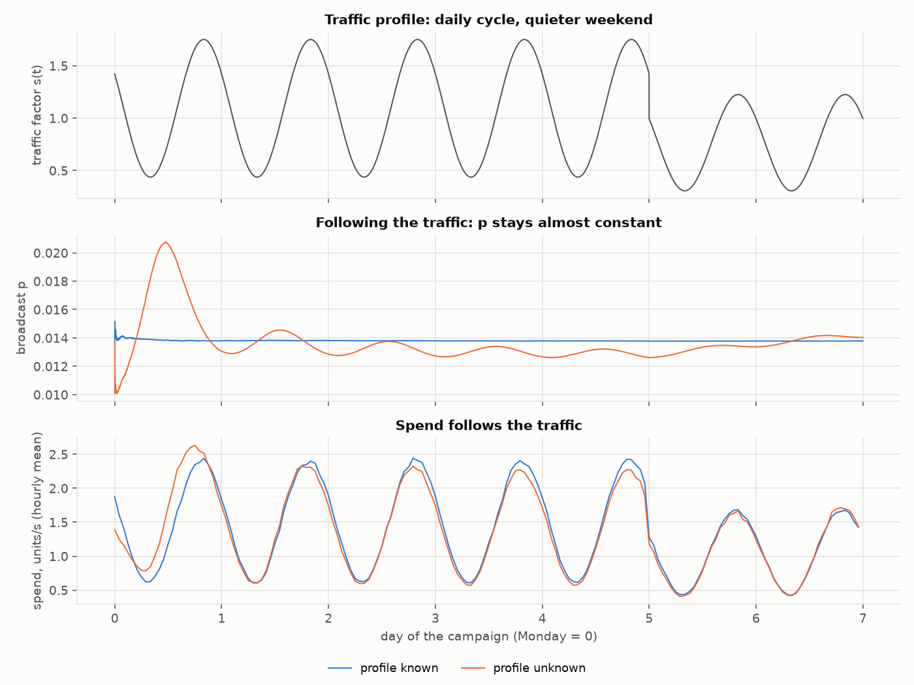
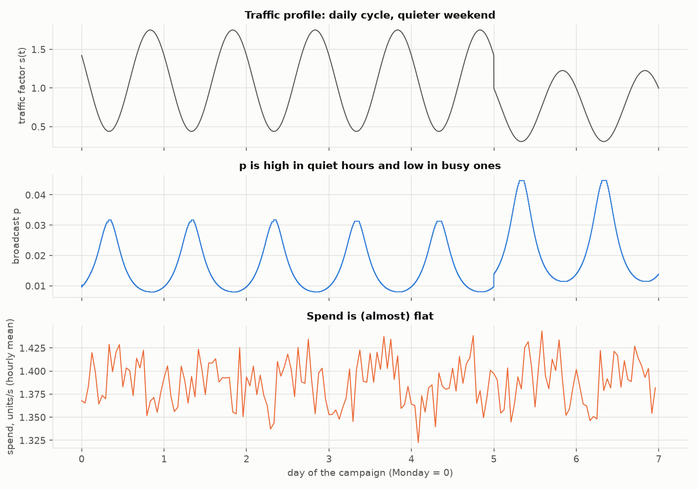

# Results: probabilistic controller, traffic that varies

Model: [models/seasonal/probabilistic.md](../../models/seasonal/probabilistic.md). Generated by `uv run python -m pacing.seasonal_experiments`.

A 30-day campaign starting on a Monday at 00:00: B = 3,600,000 units, k0 = 100 spends/s at p = 1 on average, control step 60 s, spend delay d = 30 s, ε = 0.01. The traffic profile has a daily cycle (factor 1 ± 0.6, peak at 20:00) and quieter weekends (0.7). Pacing follows the traffic. 4000 runs per row. The deviation is measured against the traffic-following target.

| setting | P(overspend) | 95% upper bound | worst overspend, units | mean underspend, units | mean underspend % | max deviation from the traffic target % |
|---|---|---|---|---|---|---|
| constant traffic (reference) | 8.75e-03 | 1.2e-02 | 15 | 28 | 0.0008 | 0.05 |
| traffic varies, profile known | 7.75e-03 | 1.0e-02 | 17 | 33 | 0.0009 | 0.05 |
| traffic varies, profile unknown | 1.47e-01 | 1.6e-01 | 14 | 3 | 0.0001 | 0.57 |
| profile unknown, risk check on the last 1 h | 1.75e-03 | 3.3e-03 | 2 | 11 | 0.0003 | 0.57 |
| profile unknown, risk check on the last 10 min | 6.25e-03 | 8.7e-03 | 6 | 9 | 0.0003 | 0.57 |
| profile wrong (peak at 16 h, no weekend dip) | 2.36e-01 | 2.5e-01 | 8 | 1 | 0.0000 | 1.12 |
| profile wrong, risk check on the last 1 h | 5.40e-02 | 6.0e-02 | 7 | 4 | 0.0001 | 1.12 |
| ends at 08:00 (low traffic), profile known | 1.03e-02 | 1.3e-02 | 11 | 17 | 0.0005 | 0.05 |
| ends at 08:00 (low traffic), profile unknown | 0 | 7.5e-04 | 0 | 971 | 0.0270 | 0.53 |

## Spending evenly in time

The pacing goal changes from following the traffic to a constant spend rate: p = (budget left / time left) / (current spend rate at p = 1), so p is high in quiet hours and low in busy ones. Without a profile, the current rate comes from recent data. If a quiet hour cannot keep up even at p = 1, the shortfall raises the target rate for the rest of the campaign (catch-up). Deviation is measured against the even-in-time line. All rows send p only when it changes by more than 2 %. 4000 runs per row.

| setting | P(overspend) | worst overspend, units | mean underspend, units | max deviation from even spending % | p range (days 1-29, one run) | share of steps at p = 1 | p messages per hour (2 % threshold) |
|---|---|---|---|---|---|---|---|
| follow the traffic, profile known (for comparison) | 7.50e-03 | 18 | 33 | 1.46 | 0.0137–0.0140 | 0% | 0.0 |
| even in time, profile known | 1.00e-02 | 11 | 28 | 0.05 | 0.0080–0.0453 | 0% | 5.3 |
| even in time, profile unknown, current rate from the last 1 h | 0 | 0 | 35 | 1.16 | 0.0072–0.0424 | 0% | 5.1 |
| even in time, profile unknown, current rate from the last 10 min | 5.00e-03 | 14 | 30 | 0.06 | 0.0075–0.0488 | 0% | 6.8 |
| even in time, profile wrong | 4.01e-01 | 16 | 1 | 1.97 | 0.0073–0.0333 | 0% | 5.2 |
| budget × 50: even in time, profile known | 0 | 0 | 898704 | 4.78 | 0.4012–1.0000 | 6% | 2.7 |
| budget × 50: follow the traffic, profile known | 1.15e-02 | 124 | 249 | 1.45 | 0.6901–0.6901 | 0% | 0.0 |

