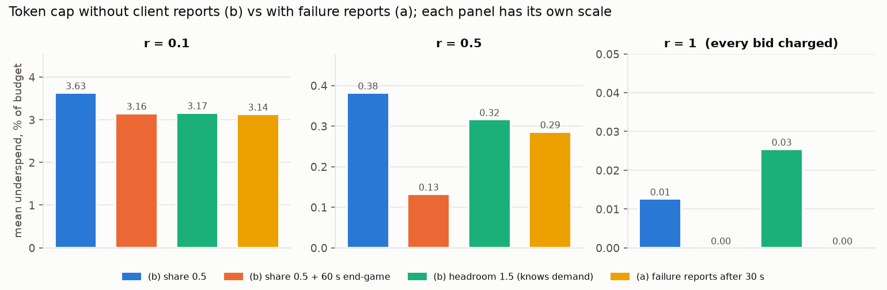
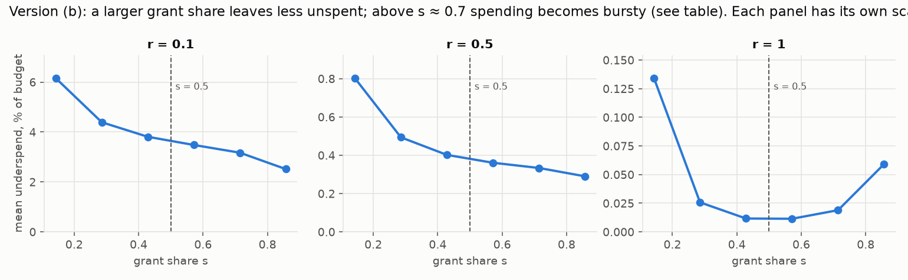

# Results: token cap, version (b), no reports from clients

Model: [models/token-cap-b.md](../models/token-cap-b.md). Generated by `uv run python -m pacing.backstop`.

Each step the center grants tokens that expire at the end of the step, at most A = B − S_obs − (tokens granted in the last d seconds). Clients report nothing. Grant rules: *share 0.5* grants half of A (needs no information). *Headroom 1.5* grants 1.5 × the expected bid demand λ·p·Δ, which assumes the center knows the demand, for example from usage counts. For comparison, version (a) cap only with d_f = d = 30 s.

| r | strategy | overspends | mean underspend % | p95 underspend % | runs where cap blocked bids | max pacing deviation % |
|---|---|---|---|---|---|---|
| 0.1 | (b) share 0.5, cap only | 0 | 3.63 | 4.08 | 100.0 % | 3.63 |
| 0.1 | (b) share 0.5, cap only + 60 s end-game | 0 | 3.16 | 3.58 | 100.0 % | 3.23 |
| 0.1 | (b) headroom 1.5, cap only | 0 | 3.17 | 3.58 | 100.0 % | 3.17 |
| 0.1 | (b) headroom 1.5, cap only + 60 s end-game | 0 | 2.69 | 3.08 | 100.0 % | 2.88 |
| 0.1 | (a) d_f = 30 s, cap only (reference) | 0 | 3.14 | 3.54 | 100.0 % | 3.14 |
|  |  |  |  |  |  |  |
| 0.5 | (b) share 0.5, cap only | 0 | 0.38 | 0.54 | 100.0 % | 1.44 |
| 0.5 | (b) share 0.5, cap only + 60 s end-game | 0 | 0.13 | 0.22 | 100.0 % | 2.77 |
| 0.5 | (b) headroom 1.5, cap only | 0 | 0.32 | 0.46 | 100.0 % | 1.43 |
| 0.5 | (b) headroom 1.5, cap only + 60 s end-game | 0 | 0.10 | 0.18 | 100.0 % | 2.77 |
| 0.5 | (a) d_f = 30 s, cap only (reference) | 0 | 0.29 | 0.42 | 100.0 % | 1.45 |
|  |  |  |  |  |  |  |
| 1 | (b) share 0.5, cap only | 0 | 0.01 | 0.06 | 100.0 % | 1.44 |
| 1 | (b) share 0.5, cap only + 60 s end-game | 0 | 0.00 | 0.00 | 100.0 % | 2.80 |
| 1 | (b) headroom 1.5, cap only | 0 | 0.03 | 0.10 | 100.0 % | 1.36 |
| 1 | (b) headroom 1.5, cap only + 60 s end-game | 0 | 0.00 | 0.00 | 100.0 % | 2.76 |
| 1 | (a) d_f = 30 s, cap only (reference) | 0 | 0.00 | 0.00 | 100.0 % | 1.45 |
|  |  |  |  |  |  |  |

## Grant share s (cap only, plain pacing)

| r | s = 0.14 | s = 0.29 | s = 0.43 | s = 0.57 | s = 0.71 | s = 0.86 |
|---|---|---|---|---|---|---|
| 0.1 | 6.16 % (dev 6.2 %) | 4.39 % (dev 4.4 %) | 3.81 % (dev 3.8 %) | 3.48 % (dev 3.5 %) | 3.17 % (dev 3.3 %) | 2.51 % (dev 6.7 %) |
| 0.5 | 0.80 % (dev 1.4 %) | 0.49 % (dev 1.4 %) | 0.40 % (dev 1.4 %) | 0.36 % (dev 1.4 %) | 0.33 % (dev 1.7 %) | 0.29 % (dev 4.5 %) |
| 1 | 0.13 % (dev 1.4 %) | 0.03 % (dev 1.4 %) | 0.01 % (dev 1.4 %) | 0.01 % (dev 1.4 %) | 0.02 % (dev 1.6 %) | 0.06 % (dev 3.9 %) |

Cells: mean underspend (max pacing deviation).

## Lost connection between center and clients

No message passes either way during the outage; clients keep the last p for their silence limit (15 s), then stop. Plain pacing with the cap, grant share 0.5; while cut off no grant arrives. 20000 runs per row.

| r | outage | overspends | mean underspend % | max pacing deviation % |
|---|---|---|---|---|
| 0.1 | no outage | 0 | 3.63 | 3.63 |
| 0.1 | 60 s from 3300 s | 0 | 4.26 | 4.26 |
| 0.1 | 60 s from 3500 s | 0 | 4.26 | 4.26 |
| 0.1 | from 3300 s to the end | 0 | 8.01 | 8.01 |
| 0.1 | 300 s from 1000 s | 0 | 3.10 | 8.02 |
| 0.1 | from 3300 s to the end, p = 1 throughout | 0 | 0.01 | – |
|  |  |  |  |  |
| 1 | no outage | 0 | 0.01 | 1.44 |
| 1 | 60 s from 3300 s | 0 | 0.01 | 1.50 |
| 1 | 60 s from 3500 s | 0 | 0.14 | 1.46 |
| 1 | from 3300 s to the end | 0 | 7.57 | 7.57 |
| 1 | 300 s from 1000 s | 0 | 0.01 | 8.15 |
| 1 | from 3300 s to the end, p = 1 throughout | 0 | 0.00 | – |
|  |  |  |  |  |

## Spend delay that varies

Each spend shows up after its own random delay. Version (b) counts each grant as unresolved for its window and then assumes its spend is visible. The window is the mean delay, the 99.9 % quantile, or the longest possible delay (600 s for the truncated tails). Plain pacing with the cap. 20000 runs per row.

| r | delay | window | overspends | mean underspend % |
|---|---|---|---|---|
| 0.1 | exponential, mean 30 s | mean (30 s) | 0 | 3.59 |
| 0.1 | exponential, mean 30 s | 99.9 % (207 s) | 0 | 31.03 |
| 0.1 | exponential, mean 30 s | longest (600 s) | 0 | 72.06 |
| 0.1 | uniform 10-50 s | mean (30 s) | 0 | 3.59 |
| 0.1 | uniform 10-50 s | 99.9 % (50 s) | 0 | 5.93 |
| 0.1 | uniform 10-50 s | longest (50 s) | 0 | 5.93 |
| 0.1 | lognormal, median 20 s, sigma 1 | mean (33 s) | 0 | 4.11 |
| 0.1 | lognormal, median 20 s, sigma 1 | 99.9 % (440 s) | 0 | 58.64 |
| 0.1 | lognormal, median 20 s, sigma 1 | longest (600 s) | 0 | 72.06 |
|  |  |  |  |  |
| 1 | exponential, mean 30 s | mean (30 s) | 18978 | 0.00 |
| 1 | exponential, mean 30 s | 99.9 % (207 s) | 0 | 3.32 |
| 1 | exponential, mean 30 s | longest (600 s) | 0 | 42.17 |
| 1 | uniform 10-50 s | mean (30 s) | 17813 | 0.00 |
| 1 | uniform 10-50 s | 99.9 % (50 s) | 0 | 0.30 |
| 1 | uniform 10-50 s | longest (50 s) | 0 | 0.30 |
| 1 | lognormal, median 20 s, sigma 1 | mean (33 s) | 17971 | 0.00 |
| 1 | lognormal, median 20 s, sigma 1 | 99.9 % (440 s) | 0 | 21.73 |
| 1 | lognormal, median 20 s, sigma 1 | longest (600 s) | 0 | 42.31 |
|  |  |  |  |  |
